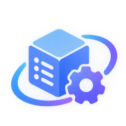
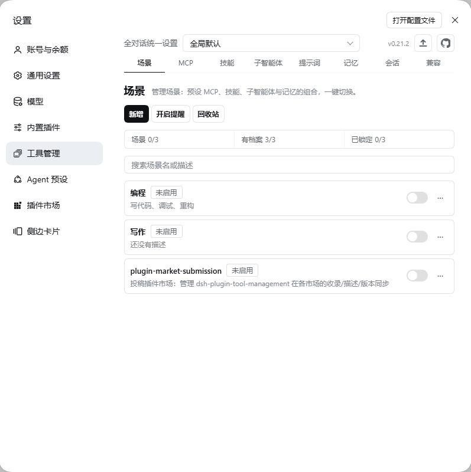
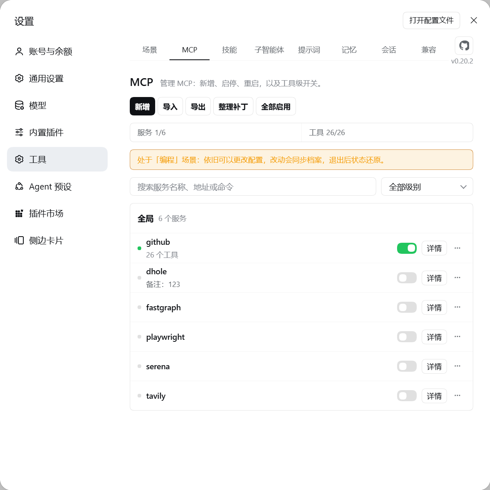
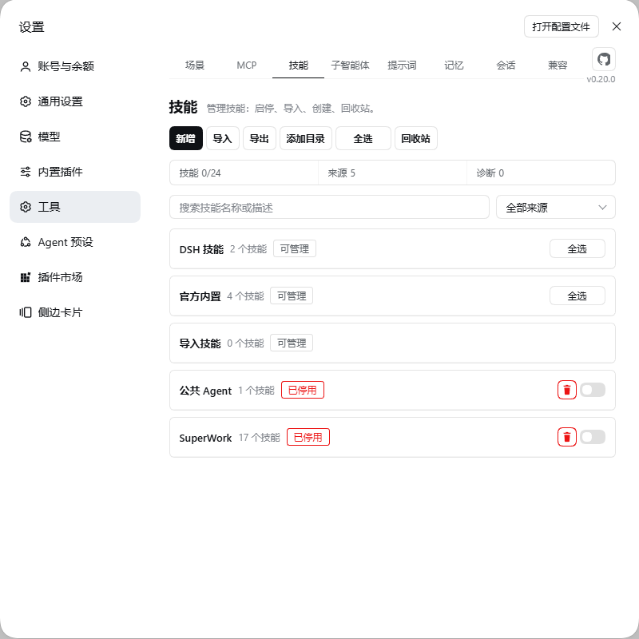
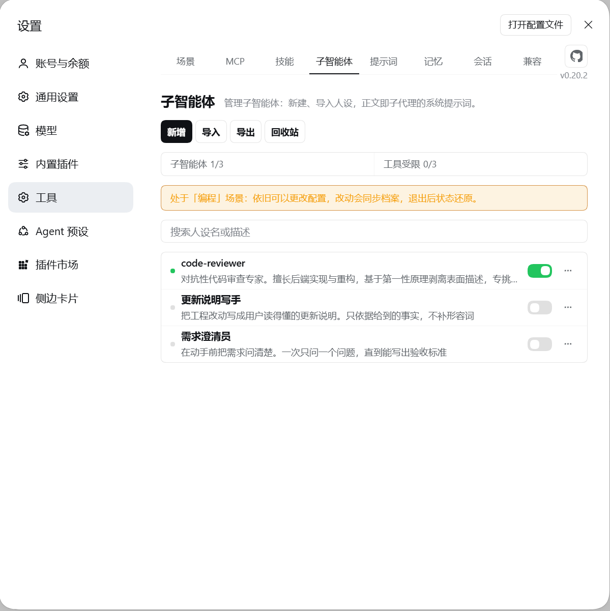
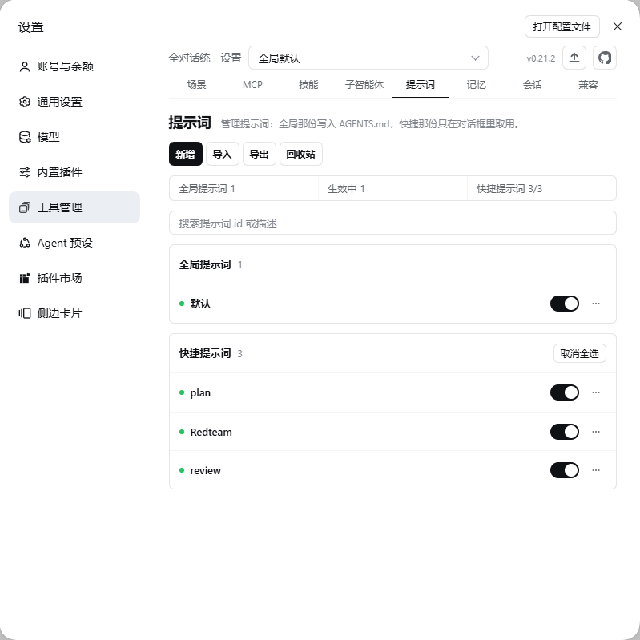
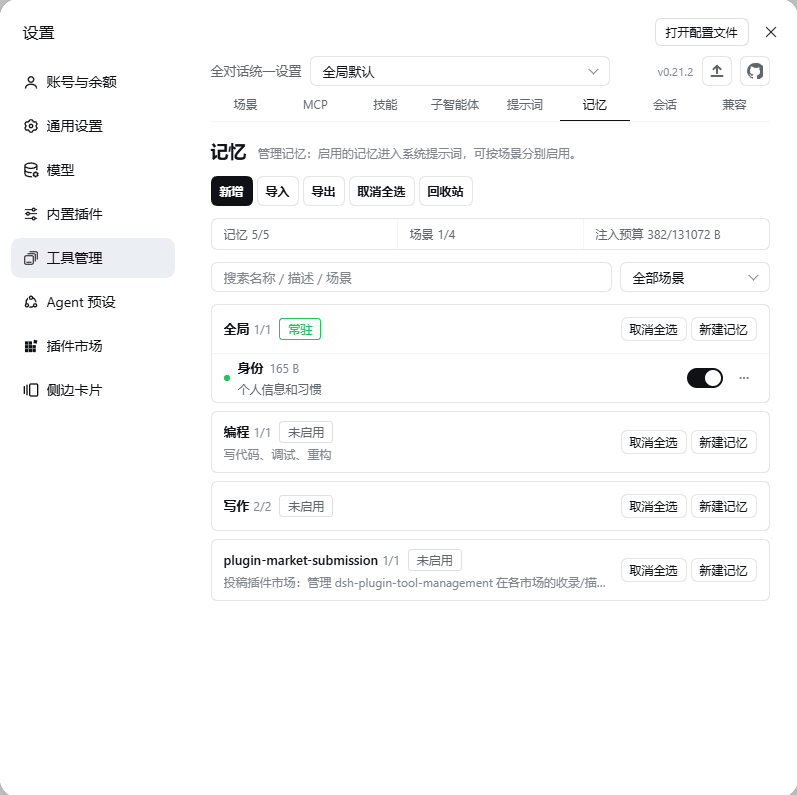
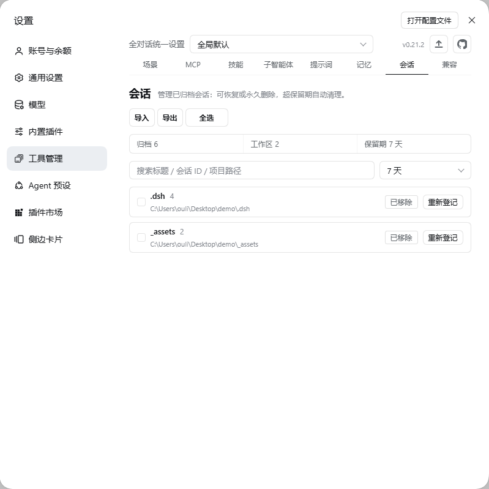
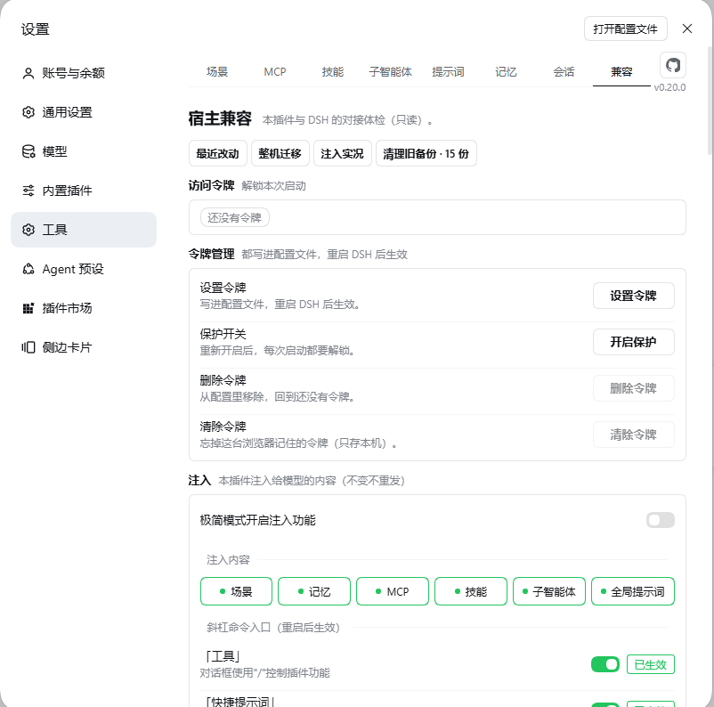

<p align="center">
  
</p>

# dsh-plugin-tool-management

[](https://www.npmjs.com/package/dsh-plugin-tool-management)
[](LICENSE)
[](package.json)
[](https://github.com/ouli-1242/dsh-plugin-tool-management)

[](https://dsh.market/)
[](https://awesome-dsh-plugin.com)
[](https://dshfind.com/zh/plugins/ouli-1242/dsh-plugin-tool-management)
[](https://github.com/0xsline/awesome-deepseek-harness)

**简体中文** · [English](README_EN.md) · [Changelog](CHANGELOG.md) · [版本更新概要](docs/update.md)

DeepSeek Harness 的 **MCP、技能、场景、记忆、子智能体、提示词与归档会话**管理插件。八个页签：场景 / MCP / 技能 / 子智能体 / 提示词 / 记忆 / 会话 / 兼容。

```sh
dsh plugin --profile web add dsh-plugin-tool-management@latest      # web 版
dsh plugin --profile desktop add dsh-plugin-tool-management@latest  # 桌面版
```

装完 web 版硬刷新浏览器（Cmd/Ctrl+Shift+R），桌面版重启应用，设置 → **工具管理**。插件只写自己的文件，不改技能源文件；重启与升级后配置都在。

---

## 演示视频

<video controls src="https://github.com/user-attachments/assets/3bed27b0-2d73-4e89-b1dd-f2b1cbd6eaca"></video>

<video controls src="https://github.com/user-attachments/assets/7c72ce98-fad9-4233-88de-2ebf5ca5bf30"></video>

画面里每一个界面都是真机截图，没有重画的 UI，也没有伪造控件。

背景音乐：Kevin MacLeod「Limit 70」，[CC BY 4.0](https://creativecommons.org/licenses/by/4.0/)。

---

## 截图

|                              |                                |
|:----------------------------:|:------------------------------:|
|    |       |
| **场景**                     | **MCP**                        |
|    |  |
| **技能**                     | **子智能体**                   |
|  |      |
| **提示词**                   | **记忆**                       |
|    |      |
| **会话**                     | **兼容**                       |

## 核心亮点

一句话：**把「工作 / 写作 / 编程」各配成一套场景，点一下整套切换；插件管的东西，模型都看得见。**

| 亮点                        | 说明                                                                                                                               |
| --------------------------- | ---------------------------------------------------------------------------------------------------------------------------------- |
| 一键换场景                  | 每个场景各配一套 MCP / 技能 / 人设 / 记忆，进入时整套切换、退出时还原；模型也能按你说的切                                          |
| 不离开对话就能管            | 对话里打 `/` 出「工具」段，启停各域条目，点一下就生效                                                                              |
| 记忆自动送到模型眼前        | 每个场景下写几段 `.md` 就是它的资料库，正文自动进上下文                                                                            |
| 给 MCP 服务器写备注         | 写进备注的话模型每轮都看得到，会照做                                                                                               |
| 单个工具也能关              | 一台服务器里可以只停某个工具，模型看不见也调不到                                                                                   |
| 技能状况一眼看穿            | 哪份在生效标「首选」，被同名覆盖的标出来源                                                                                         |
| 子智能体 = 一个文件一个角色 | 写一份角色说明就能派活；跑完只回结果、不占你的会话记录                                                                             |
| 提示词备好几套              | `AGENTS.md` 可以存多份、一键切换；场景可以各自绑一份，也可以选「无」（不绑）                                                       |
| 会话不再丢                  | 归档按项目分组、能搜、能批量恢复；Claude Code / Cursor / Codex 的记录能导进来                                                      |
| 模型一定看得见              | 六个域各注入一条上下文，内容没变不重发                                                                                             |
| 锁住就不怕手滑              | 场景可以上锁：五个域的增删改整体只读                                                                                               |
| 删了能找回                  | 技能 / 记忆 / 人设 / 提示词 / 场景的删除都进回收站（会话永久删除除外）；可勾选批量永久删除，也可设保留期让它自动清（默认永久保留） |
| 安全、不添乱                | 只写自己的文件；密钥默认打码、看明文要令牌                                                                                         |
| 对话 / 工作区各管各的       | 面板顶部先选层，各域开关只影响那一层（全部全局 / 按对话 / 按工作区）；其他层原样不动                                                         |

## 快速开始

前置：DSH 已安装（`dsh web` 可运行），Node.js ≥ 18。命令按端选：`--profile web` 装 web 版，`--profile desktop` 装桌面版。桌面版的 profile 由 DSH Desktop 自己初始化 —— 先打开过一次应用，执行命令前把它完全退出。

```sh
dsh plugin --profile web add dsh-plugin-tool-management@latest         # web 版 · 安装 / 更新
dsh plugin --profile web remove dsh-plugin-tool-management             # web 版 · 卸载
dsh plugin --profile desktop add dsh-plugin-tool-management@latest     # 桌面版 · 安装 / 更新
dsh plugin --profile desktop remove dsh-plugin-tool-management         # 桌面版 · 卸载
```

装完 web 版硬刷新浏览器、桌面版重启应用，设置 → **工具管理** 出现八栏即成功。界面改动即时生效，宿主侧改动需重启（web 重启 `dsh web`，桌面重启桌面应用）。

也可以让模型代劳：

```text
安装 dsh-plugin-tool-management 插件：
dsh plugin --profile web add dsh-plugin-tool-management@latest
装完提醒我硬刷新浏览器。
```

桌面版把 `web` 换成 `desktop`，最后一句改成「装完提醒我重启桌面应用」。

## 功能

### 斜杠命令（在对话里直接管）

- **打 `/` 出「工具」段**：六行 —— 场景 / 技能 / MCP 服务器 / 子智能体 / 提示词 / 记忆。点一行进这一域，再点一条直接生效；点完菜单不关，也不在输入框留下那串命令字。
- **状态看得见**：启用项绿勾、停用项空框，右侧灰字是条目备注，域行右侧给当前态摘要。
- **条目多也不挡路**：每域全量列出、面板自己滚；技能按来源目录分组、记忆按场景分组，已启用的排前面。
- **提示词两类都在**：全局那组选哪一份写进 `AGENTS.md`（单选），快捷那组是启停，点一行把存好的话贴进输入框、不自动发送。
- **只放可逆动作**：进场景与各类启停；增删改、导入导出、改配置仍各归各页。
- **走宿主官方通道**：用 DSH 的输入触发器接口注册，不 patch 官方包。

### 作用域隔离（全部全局 / 按对话 / 按工作区）

- **一套界面，三档粒度**：兼容页可切「全部全局 / 按对话 / 按工作区」——全局档没有会话层、所有对话共用一套（加会话管理之前的样子），按对话时 A 关掉的不影响 B，按工作区时同一工作区共用一份、不同工作区仍隔离；无 cwd 或路径超长的对话仍各自独立；切走不删记录，调回即恢复。
- **四层叠加**：本层改过 > 进入的场景 > 创建时的快照 > 全局，逐格取最上面有话说的一层；拨回与下层一致时覆盖自动清掉。
- **对话里能进出场景**：场景页与斜杠菜单都能进入，档案里勾的记忆 / 技能 / 人设 / MCP 按当前层实时生效；退出回到这一层最开始的样子（不回退到会变的全局）。
- **八个域都能按当前层改**：场景、技能（含来源目录）、子智能体、记忆、快捷提示词、MCP 服务器与逐工具可见性、模型工具表（每层一份整名单，全局那份只是新对话 / 新工作区的默认）。
- **全局关着也能临时用，徽章照实算**：服务器 / 技能来源按租约临时运行，别的层看不见；七个域与逐工具一格都有徽章，按当前粒度现算；行菜单「彻底停止」压过一切。
- **提示词也能按当前层覆盖**：应用预设或编辑正文只改这一层（写侧车，不写 `~/.dsh/AGENTS.md`）；预设库仍是全局资产，切回全局层再改。
- **模型工具默认写当前层**：回执说清写的是哪一层，`scope: "global"` 才改全局；两把锁互不干扰 —— 场景锁冻结全局写入，会话 / 工作区锁只冻结那一层。

### 场景与记忆

- **场景 = 分组，记忆 = `.md` 文件**：`memories/<场景>/<名>.md`，整篇正文自动注入上下文，文件名支持中文。
- **「启用」与「进入」是两件事**：启用决定注入按哪个场景走（单选，全关 = 只注入「全局」与 `_shared`）；进入才按档案整套切换 MCP / 技能 / 人设，并把绑定的提示词写进 `AGENTS.md`。
- **场景档案**：每个场景搭配 MCP 工具集与场景级备注 / 技能集 / 子智能体 / 快捷提示词 / 模型工具表方案，外加一份绑定的全局提示词预设；段内勾的启用、没勾的停用，整段没建 = 该域全部停用（快捷提示词例外：没绑 = 进入时不碰），退出时按进场景前的快照还原。
- **每格另给一档「无」**：这一域本场景不碰（提示词那格 = 进出都保持原样，快捷提示词 = 一条都不启用）。它区别于「保持现状」——那一档才是真的不动。
- **退出场景保留「取消应用」**：退出只是退回全局，应用前那份 `AGENTS.md` 仍可用「取消应用」一键找回。
- **场景锁定**：锁定后 MCP / 技能 / 子智能体 / 记忆 / 提示词五域的增删改整体只读。
- **删除场景 = 连记忆一起删**：场景记录、档案与全部记忆进同一条回收站条目，恢复时整条放回；使用中的场景拒绝删除。
- **导入导出**：`.md` / `.zip`（目录名 = 场景，bundle 带附件），同名跳过绝不覆盖；注入预算默认 128 KiB，放不下的跳过并列出清单。

### 子智能体

- **一个文件一个人设**：`subagents/<人设>.md`，frontmatter 全可选；`output:` 一行一条写"产出必须长什么样"。正文原样用在 `# Persona: <名字>` 标题下，人设文件本身不用改。
- **委派**：`subagent_manager_run` 带人设运行、只回最终结果、不进 History；默认新起独立会话，`inherit: true` 继承本次会话已完成的轮次。
- **启停与目录**：停用的人设不注入、模型不可见（文件不动）；新建 / 导入 / 恢复默认停用。人设目录只列名字 + 描述。
- **工具限制按 Agent 预设**：每个预设一份白 / 黑名单（互斥），候选只列该预设自己的工具，分「插件工具 / 官方工具 / 其他工具」三段。
- **模型与来源**：都从宿主 LLM 目录里选（选定来源后模型只列该来源的）；留空 = 继承主会话；思考强度档位由所选模型声明。

### MCP 服务

- **增删改查、即改即生效**：写入 `cordis.patch.yml`，改前自动备份。级别分「全局 / 应用级」，新增默认全局。
- **工具级开关**：单个工具可独立停用（模型看不见也调不到），整台支持批量。
- **停着也能看清单**：没在跑的服务器仍显示上次见过的工具名与描述（标「上次运行时」）；从没跑过的可以一键启动读取。
- **备注与密钥**：每台服务器可写一句给模型的提示，随状态段一起注入；凭据默认整值打码（`$VAR`、`!!js` 这类间接引用不动），看明文要令牌。
- **迁移与备份**：跨项目级 / 全局迁移失败自动回滚；支持 JSON 导出导入。

### 技能

- **来源一览**：项目级 / DSH / Agents / Codex / Claude / 自定义目录，按来源分组。
- **两组权限相反**：默认来源的技能可删可停；外部目录可以停用或移除，但里面的技能文件只读。
- **移除 ≠ 停用**：移除 = 连目录都不扫（文件零改动，可恢复）；停用 = 仍列出但不可调用。
- **同名谁在生效**：生效的那份标「首选」，被覆盖的标出来源。
- **自定义目录 / ZIP 导入导出 / 回收站**。

### 提示词预设

- 多套 `~/.dsh/AGENTS.md` 基线一键应用（下一轮对话生效），保留 5 代备份；每条预设可写一句"这份是干什么的"，只存在插件侧、不进 `AGENTS.md`；「最近一次应用的是哪份」也答得出来（手改过也认得出源）。
- **生效与否就是卡片左边那颗开关**：点亮 = 把这一份写进 `AGENTS.md`；再点一下 = **取消应用**。点之前弹窗会说清是哪种（删文件时按钮变红），点完还给一条回执。
- **「取消应用」一步回到链起点**，不是只退一步：这一串应用 / 取消往复开始之前是什么样就恢复成什么样（起点没有 `AGENTS.md` 就把文件删掉）；中途每一份内容都留在 `__last-applied__/AGENTS.md.bak-*`（保留 5 代），随时能再应用回来。
- **两类不能直接删**：**被场景绑定的**、以及**当前应用的那一份**（后者先点开关「取消应用」就能删）；首次打开时自动生成的那份没「应用」过，可以直接删。删除一律进回收站。
- **快捷提示词**（同页第二段）：存一段常用的话，`/` 里点一下就原样贴进输入框；场景可以绑定一组（进入只启用勾的那几条、退出按进场景前还原，也可选「无」）。
- **共享的全局指令也能看见**：`~/.agents/AGENTS.md` 与别的 agent 工具共用、也在被注入；它存在时提示词页会标出来（只读，改它要去改那个文件）。

### 历史会话

- 按项目分组、搜索、批量恢复 / 永久删除、保留期自动清理；工作区登记被删后可一键重新登记。
- 导入 Claude Code / Cursor / Codex / 任意文本（工作区可挑、可浏览、可给路径）。
- 导出 Markdown / JSONL，分三档累进：仅正文 → 正文 + 工具 → 正文 + 工具 + 思考。**导出是转录，不是备份** —— 要留全量请用「归档」。

### 宿主兼容

- **「兼容」页**：宿主版本、能力可用数、每个动作走原生 / 适配 / 不可用、降级项与原因；三个写入口：访问令牌、注入设置、模型工具表。
- **兼容页功能总览**：一行一个功能点，宿主契约四条（子智能体人设委派 / 工具限制 / 创建时序 / Web 准入）与「裸模块解析」四包都列在这里，升级后哪一处悄悄不工作一眼可见。
- **侧栏入口**：侧栏里多一行「工具管理」，点开就是同一套八页；兼容页那颗「关闭侧栏 / 开启侧栏」随时能把这一行撤掉或挂回去（默认挂出，与「设置 → 工具管理」并存）。
- **命令行**：`node scripts/doctor.mjs`（体检）、`node scripts/host-deps.mjs --fix`（依赖对齐）。
- **压制型预设**（`minimal` 这类）下本插件的注入默认停用，可在「兼容」页按域强制打开。
- **关掉「技能」「提示词」的勾选 = 连宿主那份一起停**（这两域在标准预设下由官方送）；其余三域勾选完全生效。
- **注入长什么样**：每个域一条 `<system-reminder>` —— 英文模板（`# Current …` 等板块标题 + 一句"以本份为准"）包着你自己的内容，名称、说明、备注、正文一律原样注入；正文里的 `</system-reminder>` 会被转义。
- **开机自检没干完的事**：上次退出时留下的半截状态（记忆索引被隔离、MCP 重启中断在第一步）启动时核对一遍，隔离索引在场景页给一键修复，MCP 重启自动按补丁备份恢复。

---

## 数据落点

| 内容                                        | 位置                                                                      |
| ------------------------------------------- | ------------------------------------------------------------------------- |
| MCP 定义                                    | `~/.dsh/cordis.patch.yml`（插件只写它；改前自动备份到 hub 的 `backups/`） |
| 技能策略 / 自定义目录                       | `~/.dsh/tool-management/skills-state.json`                                |
| 技能 / 记忆 / 人设 / 预设                   | `~/.dsh/tool-management/{skills,memories,subagents,prompts}/`             |
| 子智能体启停                                | `~/.dsh/tool-management/subagents-index.json`                             |
| 回收站（技能 / 记忆 / 人设 / 预设 / 场景）  | `~/.dsh/tool-management/trash/<域>-trash/`（每类一个目录）                |
| 归档账本 / 保留期                           | `~/.dsh/tool-management/history-*.json`                                   |
| 回收站保留期                                | `~/.dsh/tool-management/trash-retention.json`（`0` = 永久保留）           |
| 记忆索引 / 场景 / 档案                      | `~/.dsh/tool-management/memories-index.json`                              |
| MCP 侧车（停用表 / 已知工具 / 备注 / 设置） | `~/.dsh/tool-management/mcp-*.json`                                       |
| 注入设置（六个域开关）                      | `~/.dsh/tool-management/inject-settings.json`                             |
| 模型工具表（全局默认 + 存下的方案）         | `~/.dsh/tool-management/tool-table.json`                                  |
| 作用域覆盖（会话 / 工作区，含工具表）       | `~/.dsh/tool-management/scope-overrides.json`                             |
| 全局意图（MCP / 技能来源的默认开关）        | `~/.dsh/tool-management/scope-intent.json`                                |
| 场景页界面设置（进场景前弹不弹预览卡）      | `~/.dsh/tool-management/scene-settings.json`                              |
| 运行日志 / patch 备份                       | `~/.dsh/tool-management/tool-management.log` · `backups/`                 |

**插件安装目录里不存用户数据**（`dsh plugin update` 会整体替换该目录）。备份按**每份 patch 文件各留 5 份**（全局与每个 profile 各自计），一次批量操作就可能把某层的 5 个槽位吃掉。

六类回收站各占 `trash/` 下一个目录：`{skills,memories,subagents,prompts,scenes,quick-prompts}-trash/`。记忆那一类 2026-10-10 起从 hub 根并入 `trash/`，老数据由启动迁移自动搬过去。

## 配置与安全

| 字段            | 说明                                                                                                                                           |
| --------------- | ---------------------------------------------------------------------------------------------------------------------------------------------- |
| `token`         | 访问令牌。设了之后**所有写操作 + 明文密钥**都要求 `x-dsh-token`；不设时明文接口一律关闭。也可改用环境变量 `DSH_PLUGIN_TOOL_MANAGEMENT_TOKEN`。 |
| `tokenDisabled` | `true` = 令牌保留在配置里但当前不生效（兼容页「关闭保护」写的就是这一行）。写操作不再要求令牌，明文查看仍然要。                                |
| `maxBodyBytes`  | 请求体上限，默认 88 MiB。                                                                                                                      |

**磁盘上的明文（必读）**：打码**只发生在界面展示**；MCP 的 `env` / `headers` 与插件自己的 `token` 在 `cordis.patch.yml`（及各 profile 副本）里始终明文，改配置前整份文件会备份进 `~/.dsh/tool-management/backups/`（不加密、不轮转、卸载也不回收）—— 一份密钥最多有 `5 ×（含它的 patch 文件数）+ 1` 份明文副本。令牌门禁**管不到磁盘读取**，防线是操作系统的文件权限。清理入口：**设置 → 工具管理 → 兼容 → 「清理旧备份」**。

- **浏览器**：读写走 cookie，不需要令牌；**明文密钥**（显示密钥 / 导出）要令牌。令牌在「兼容」页的「访问令牌」块管理：本次启动填一次管到 DSH 退出；写进配置文件要重启生效。
- **销毁方向一律要当场再输一次当前令牌**（关闭保护 / 修改 / 删除）—— 本次启动解锁过不算。
- **curl / 脚本**：带 `x-dsh-token`，或带浏览器 cookie。
- **HTTP 状态码**：除安全栅栏的 401 / 403 外，一律 HTTP 200 + `{ ok: false, error }` —— 脚本分流请以 `body.ok` 为准。
- **端口转发**：宿主缺 `connection` 服务时栅栏退到「Host 回环 + 同源」判定，本机进程伪造 `Host: localhost` 即可调用写 op。转发到局域网 / 公网的场景**务必配令牌** —— 陌生人注入 MCP 命令等同远程执行；「选择文件夹」弹窗用的 `dir-list` 能列出任意绝对路径（只读），同一条前提。
- **服务器名避开 `__`（起名建议）**：工具全名是 `mcp__<服务器名>__<工具名>`，服务器名里再有 `__` 会让它切不唯一，界面上的勾选可能落不到停用表里那条键上。本轮不收紧校验，改为在**兼容页**出一条提示；起名时避开 `__` 就没有这个问题。

## 常见问题

| 现象                                        | 解决                                                                                                                                        |
| ------------------------------------------- | ------------------------------------------------------------------------------------------------------------------------------------------- |
| 装完没有页面                                | 硬刷新；不行重启 DSH。                                                                                                                      |
| 重复 MCP 页签                               | 删 `cordis.patch.yml` 里的旧 loader 行后重启。                                                                                              |
| 改坏配置 DSH 起不来                         | 从 `~/.dsh/tool-management/backups/` 取最近的 `cordis.patch.yml.<层级>.bak-<时间戳>` 覆盖回去（每份 patch 各留 5 份）。                     |
| 升级 DSH 后动作不可用                       | 设置 → 工具管理 → **兼容** 看原因；`doctor.mjs` → `host-deps.mjs --fix`。                                                                       |
| 升级 DSH 后装不上 / 提示 peer 不符           | 兼容范围逐代带上界（当前一代到 `<0.2.2`），跨 minor 升级要等插件同步适配（装新宿主前先升插件）。                                               |
| 模型调不到某条工具                          | 「兼容」页的**模型工具表**看它是不是被关了（顶部先选到那个对话 / 工作区；出厂默认关着 19 条）；面板和脚本不受影响。                              |
| `approval=never` 还要确认吗                 | 不弹卡，直接放行并记日志；想问回来切回「工作区内修改」。                                                                                    |
| `subagent_manager_run` 报 provider 不可用   | 对应 provider 没注册：`spawn`（默认）/ `fork`（`inherit`）分别挂 `@deepseek-ai/dsh-subagent-spawn-in-process` / `-fork-in-process` 后重启。 |
| 场景绑了 A 人设，官方 `subagent` 还在跑别的 | 官方那两个是宿主的工具，本插件管不到；贴合人设的走 `subagent_manager_run`，官方只在没有人设贴合或要后台跑时用。                             |

---

## 开发

```bash
npm install
npm run build        # tsc + 同步客户端
npm test             # 构建 + i18n + 契约测试（纯函数不变量与宿主契约）
npm run check:i18n   # 词典自检
npm run doctor       # 宿主兼容体检
```

`lib/` 不入版本库，克隆后先 `npm run build`。改完重启 `dsh web` 才生效。运行时依赖：`fflate`（导出打包）、`js-yaml`（写宿主补丁前的解析校验，惰性加载）；`@deepseek-ai/*` 一律用宿主那份。

> **部署注意**：`npm run build` 的 profile 镜像清单**不含 `node_modules`**，本地联调时新增的运行时依赖（如 `js-yaml`）要么在 profile 侧装一份，要么接受"补丁校验跳过并上报"的降级。`npm install` 装到 profile 的正式安装不受影响。

## 许可证

MIT
