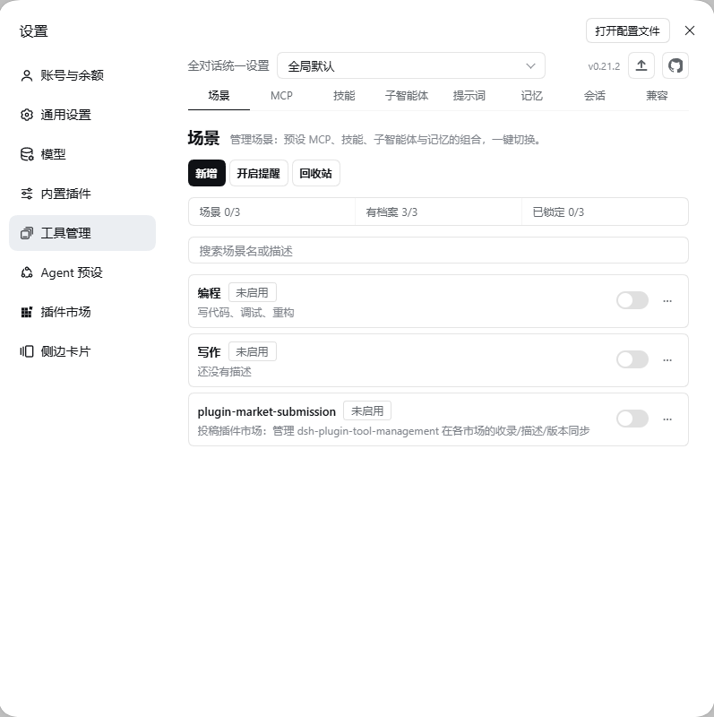
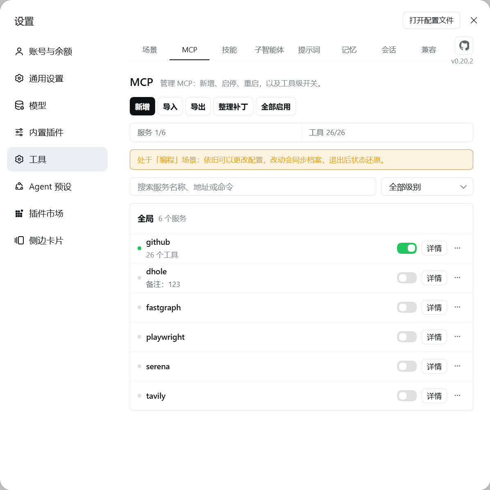
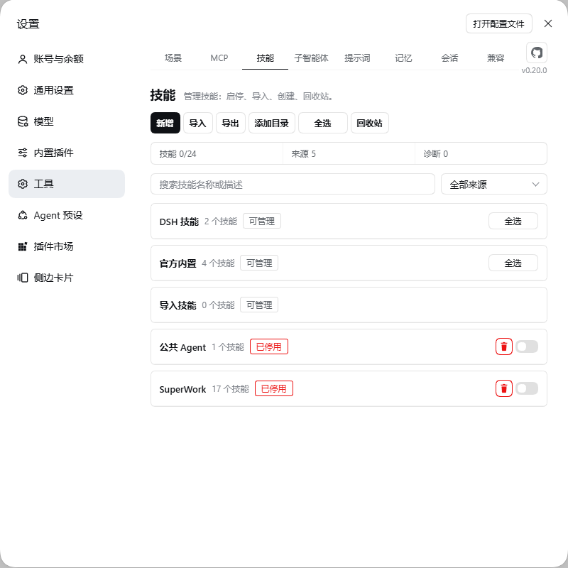
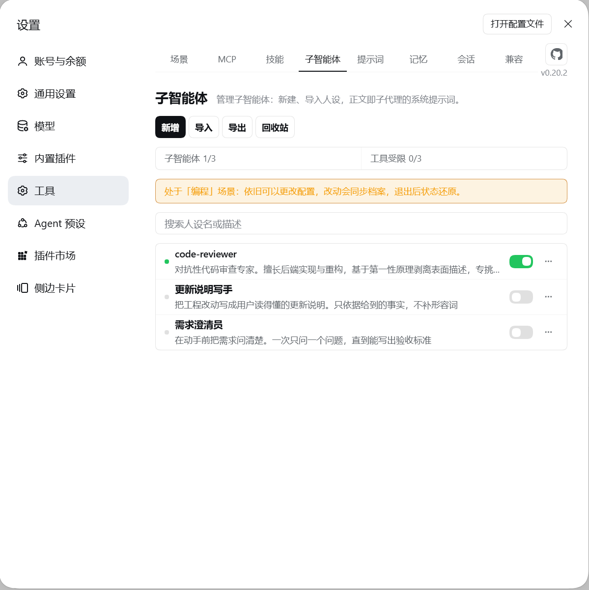
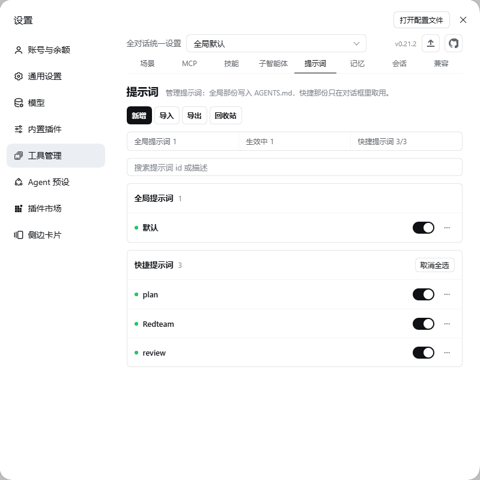
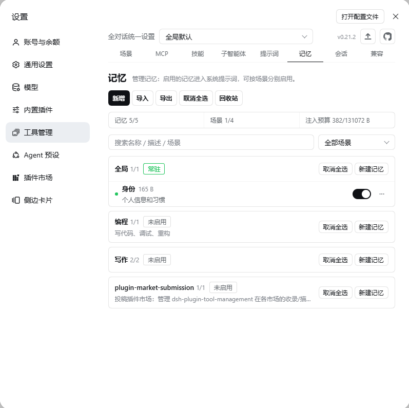
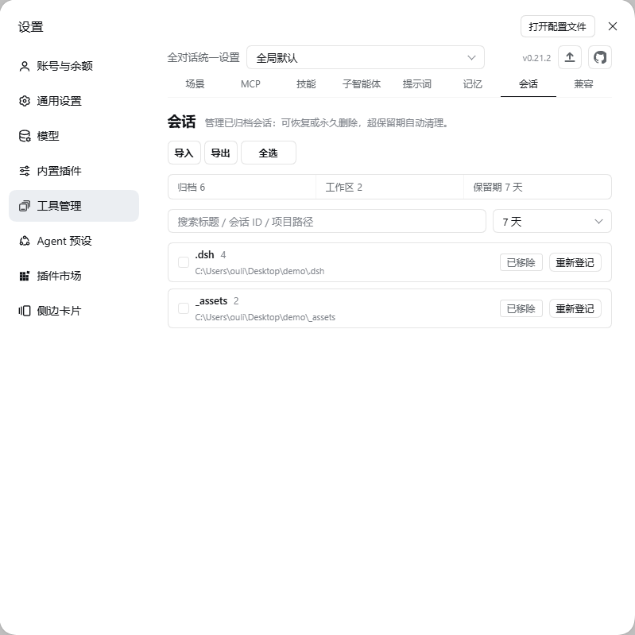
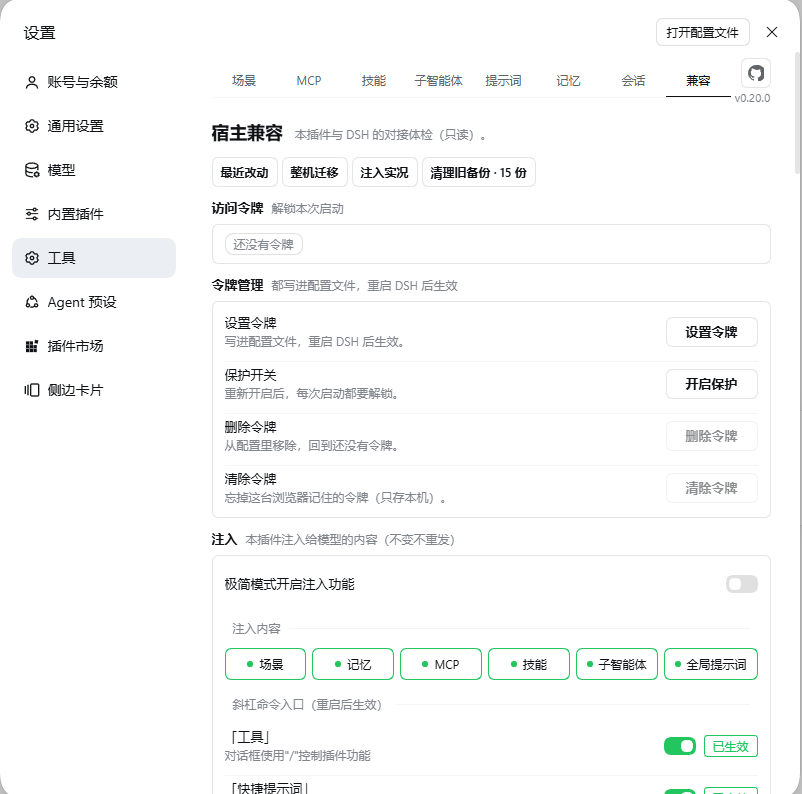

<p align="center">
  
</p>

<p align="center">
  <a href="https://www.npmjs.com/package/dsh-plugin-tool-management"></a>
  <a href="LICENSE"></a>
  
  <a href="https://github.com/ouli-1242/dsh-plugin-tool-management"></a>
</p>

<p align="center">
  <a href="https://dsh.market/"></a>
  <a href="https://awesome-dsh-plugin.com"></a>
  <a href="https://dshfind.com/zh/plugins/ouli-1242/dsh-plugin-tool-management"></a>
  <a href="https://github.com/0xsline/awesome-deepseek-harness"></a>
</p>

<p align="center">
  <b>简体中文</b> · <a href="README_EN.md">English</a> · <a href="CHANGELOG.md">更新日志</a> · <a href="docs/UPDATE.md">版本概要</a>
</p>

DeepSeek Harness 的 MCP、技能、子智能体、提示词、记忆与归档会话，都收在一个面板里。把它们配成一套，就是**场景**——点一下整套切换，退出按快照还原。

```sh
dsh plugin --profile web add dsh-plugin-tool-management@latest      # 浏览器版
dsh plugin --profile desktop add dsh-plugin-tool-management@latest  # 桌面版
```

装完浏览器硬刷新（Cmd/Ctrl+Shift+R）或重启桌面应用，打开 **设置 → 工具管理**。桌面版先打开过一次应用并完全退出，再执行命令；装到的不是最新版，多半是镜像延迟或 pnpm 的 `minimumReleaseAge`，改用确切版本号（`@0.X.X`）即可绕开。

---

## 核心亮点

<table>
<tr>
<td width="33%" valign="top"><b>一键换场景</b><br>每个场景存一份完整档案：MCP、技能、子智能体、记忆、快捷提示词、提示词预设、模型工具表。进入即整套切换，退出按快照还原。</td>
<td width="33%" valign="top"><b>在对话里控制</b><br>打 <code>/</code> 打开「工具」段：进出场景、启停六个域，点一下直接生效。菜单不关，输入框也不留命令字。</td>
<td width="34%" valign="top"><b>三种作用域</b><br>全部全局 / 按工作区 / 按会话。默认每个对话各一份设置——同一个项目里的两个对话，可以同时跑两套环境。</td>
</tr>
<tr>
<td valign="top"><b>Agent 反向控制</b><br>24 条模型工具覆盖六个域：列、读、建、改、删、启停、进场景、派子智能体。写操作弹确认卡；关掉的工具不在 schema 里，模型完全看不到。</td>
<td valign="top"><b>兼容页是总控台</b><br>版本与能力体检、访问令牌、生效层级、八个域的注入开关、模型工具表、侧栏入口，都在这一页。</td>
<td valign="top"><b>一个面板，八个页签</b><br>场景 / MCP / 技能 / 子智能体 / 提示词 / 记忆 / 会话 / 兼容，不再在六处设置之间来回找。</td>
</tr>
</table>

## 演示

<video controls width="100%" src="https://github.com/user-attachments/assets/ff3111c3-4228-45b7-9e28-b85dc60fb6b3"></video>

播放器起不来（登录态偶发被浏览器 CSP 拦）？[点此直接看同一个文件](https://github.com/user-attachments/assets/ff3111c3-4228-45b7-9e28-b85dc60fb6b3)。

画面里每个界面都是真机截图，没有重画的 UI。

背景音乐：Kevin MacLeod「Limit 70」，[CC BY 4.0](https://creativecommons.org/licenses/by/4.0/)。

## 界面

|                                                                       |                                                                           |
|:---------------------------------------------------------------------:|:-------------------------------------------------------------------------:|
| <br>**场景**     | <br>**MCP**           |
| <br>**技能**     | <br>**子智能体** |
| <br>**提示词** | <br>**记忆**         |
| <br>**会话**     | <br>**兼容**         |

## 三种作用域

默认每个对话各一份设置。在**兼容页 → 生效层级**切换一次，整个面板和模型工具都跟着这一层走：

|                | 全部全局                 | 按工作区               | 按会话（默认）         |
|:-------------- |:------------------------ |:---------------------- |:---------------------- |
| **谁共用一套** | 所有对话                 | 同一工作区的对话       | 每个对话各自一份       |
| **适合**       | 一个人一台机器，处处一致 | 一个项目一套环境       | 同一项目并行不同任务   |
| **切走会丢吗** | —                        | 不删记录，调回来即恢复 | 不删记录，调回来即恢复 |

面板顶部那条选择器可以切到某个对话或工作区，直接看它自己的那份设置；锁着的时候解锁口也在那一行。同一层里，每个开关按 **本层改过 > 进入的场景 > 创建时快照 > 全局** 取最上面有话说的一层。

场景在三种粒度下都能用。按会话时，A 对话进「编程」、B 对话留在「写作」，各自的 MCP、技能、人设互不干扰。

## 功能

<table>
<tr><th width="15%" align="left">页签</th><th align="left">做什么</th></tr>
<tr><td><b>场景</b></td><td>把整套环境存成档案，一键进入 / 退出；可锁定防误改，可绑定提示词预设与模型工具表方案；删除时连同记忆进回收站。</td></tr>
<tr><td><b>MCP</b></td><td>增删改服务器、逐工具开关、给模型写备注；没在跑也能看上次见过的工具清单；导入导出，改前自动备份。</td></tr>
<tr><td><b>技能</b></td><td>按来源分组，启停 / 移除 / 导入 / 编辑；同名技能标出谁在生效，外部目录只读。</td></tr>
<tr><td><b>子智能体</b></td><td>一个人设一个 <code>.md</code>，可派活、限工具、选模型；跑完只回结果，不占你的会话记录。</td></tr>
<tr><td><b>提示词</b></td><td>多套 <code>AGENTS.md</code> 一键应用 / 取消应用，保留 5 代备份；快捷提示词从 <code>/</code> 直接贴进输入框。</td></tr>
<tr><td><b>记忆</b></td><td>场景即分组，<code>.md</code> 正文自动进上下文；导入导出、回收站、注入预算。</td></tr>
<tr><td><b>会话</b></td><td>按项目分组归档，可搜索、批量恢复；能导入 Claude Code / Cursor / Codex 的记录，导出 Markdown / JSONL。</td></tr>
<tr><td><b>兼容</b></td><td>版本与能力体检、访问令牌、生效层级、注入开关、模型工具表、侧栏入口、清理旧备份。</td></tr>
</table>

### 自主记忆

默认关闭。打开后，agent 会把值得跨会话保留的偏好、事实与纠正记下来；**学的时候直接在对话里问你要不要加、加到哪一层**。

- **两个独立开关**：全局 / 本工作区各自开关，可都开或只开一层；学习与注入都跟随这两个开关，只开一层时卡片只列那一层。记忆页把自主记忆放在「全局」下面，工作区条目按名称分节。
- **对话里选范围**：agent 想记一条时弹卡：加入全局记忆 / 加入本工作区 / 不加入。选「加入」立即生效，不用再去记忆页确认。
- **卡片按正文语言显示，可改措辞**：卡片只用记忆正文的语言；在卡片里写下自己的想法，会退回模型按你的话重写并重新弹卡确认。
- **没有卡片时仍待确认**：后台复习、headless 等没有交互界面的会话仍先进「待确认」，可在记忆页逐条确认。
- **两个独立注入块**：全局自动记忆与本工作区自动记忆各占一条消息，和手写记忆分开；新增一条只重发对应那一层。
- **停用进回收站，行内可编辑**：停用不再注入，条目移入记忆页的回收站并标为自动记忆，可恢复或永久删除；行内开关与记忆一致，⋯ 菜单可改正文。
- **后台复习与维护**：每若干轮复习一次，失败有重试入口；维护扫描每天最多一次，只改状态、不删文件。
- **数据与工具表独立**：正文与状态在 `evolution/notes/`，不混进手写记忆；自主记忆工具不出现在模型工具表里，也不随场景切换，只跟两个开关走。

## 让 Agent 管这个插件

六个域共 **24 条模型工具**：列清单、读正文、新建、修改、删除、启停、进出场景、应用提示词、派子智能体。

- **默认只发 6 条**（约 1.5k token/轮），其余 18 条关着。关掉不是藏起来，是**根本没进 schema**——模型看不到，也调不到。
- **按层生效**：模型默认只改当前这一层，回执会说清写的是哪一层；带 `scope: "global"` 才动全局。
- **写操作有确认卡**：停机、删除、开关落到机器级等都会先问一句；恢复动作（重启 / 还原 / 取消应用）不拦。会话处于「完全权限」审批策略（`never`）时不弹卡、直接放行，只记一条日志。
- **逐条可开关**：兼容页的「模型工具表」按层调整，24 条全开约 6.1k token/轮；可以按任务存成不同方案，跟场景一起切。
- **关掉的模型自己能开**：常驻的那条 `tool_manager_tools` 能列出这个对话关着的工具（名字 + 用途 + ≈token）并按需打开 —— 用户说「进入某个场景」而场景工具恰好关着时，模型有路走，不用回头找用户。

## 兼容页

不只是版本号：

- **体检**：宿主版本、这一轮实际加载的插件版本、每个动作走原生 / 适配 / 不可用及原因。升级后哪一处悄悄失效，一眼看到；页头「重新检测」可原地复核。
- **升级差异**：逐包对照 cordis、11 个 peer 与 15 个运行时官方包的版本和适配基准（超出 peer 范围直接进阻塞项），并把事件名、会话目录布局、补丁方言、MCP 配置键与工具参数表、提示词段排序位、客户端界面槽位、官方技能资产等宿主契约的 canary 一并列出。
- **访问令牌**：设置 / 关闭 / 修改 / 删除；写操作与明文密钥都走它。
- **生效层级**：全部全局 / 按工作区 / 按会话，一键切。
- **注入**：八个域各自开关、极简模式兜底注入、技能 / MCP / 子智能体的目录上限（超出的折叠为一行，描述字符数也可配）、斜杠命令两段入口、侧栏入口。
- **模型工具表**：27 条逐条可见性，按层保存方案。
- **维护**：清理旧备份、功能总览、最近改动。

<details>
<summary><b>数据落在哪 · 安全边界</b></summary>

| 内容                                        | 位置                                                              |
|:------------------------------------------- |:----------------------------------------------------------------- |
| MCP 定义                                    | `~/.dsh/cordis.patch.yml`（全局）· `~/.dsh/profiles/<名>/cordis.patch.yml`（当前档案） |
| 技能策略 / 自定义目录                       | `~/.dsh/tool-management/skills-state.json`                        |
| 技能 / 记忆 / 人设 / 预设                   | `~/.dsh/tool-management/{skills,memories,subagents,prompts}/`     |
| 记忆索引 / 场景 / 档案                      | `~/.dsh/tool-management/memories-index.json`                      |
| 回收站（技能 / 记忆 / 人设 / 预设 / 场景）  | `~/.dsh/tool-management/trash/<域>-trash/`                        |
| 归档账本 / 保留期                           | `~/.dsh/tool-management/history-*.json`                           |
| MCP 侧车（停用表 / 已知工具 / 备注 / 设置） | `~/.dsh/tool-management/mcp-*.json`                               |
| 注入设置（八个域开关 · 目录上限）           | `~/.dsh/tool-management/inject-settings.json`                     |
| 模型工具表 / 作用域覆盖                     | `~/.dsh/tool-management/tool-table.json` · `scope-overrides.json` |
| 运行日志 / patch 备份                       | `~/.dsh/tool-management/tool-management.log` · `backups/`         |

- **写入范围**：技能源文件只读；MCP 只改上面那两份 patch（各留 5 份备份）；提示词「应用」会覆盖宿主读的 `~/.dsh/AGENTS.md`（原文留在 hub 内）；桌面版启动时清掉 10 分钟前的 `dsh-auth-*` cookie。
- **令牌**：设置后所有写操作与明文密钥都要 `x-dsh-token`；界面填一次后存在浏览器 localStorage、与本次启动绑定（重启要重填），明文查看仍要令牌。
- **进程级边界靠令牌**：写接口默认由宿主的浏览器鉴权把关；宿主栅栏缺席时退回只查回环地址的本地判定，本机其它进程即可直连——配了访问令牌才有进程级这道门。
- **磁盘上是明文**：打码只发生在界面。MCP 的 `env` / `headers` 与插件的 `token` 在 patch 文件里始终明文，备份也不加密。令牌门禁管不到磁盘读取，防线是文件权限。
- **删除可找回**：技能 / 记忆 / 人设 / 提示词 / 场景的删除都进回收站（会话永久删除除外），可设保留期自动清理（默认永久保留）。

</details>

## 常见问题

| 现象                  | 解决                                                                                        |
|:--------------------- |:------------------------------------------------------------------------------------------- |
| 装完没有页面          | 硬刷新浏览器；还不行就重启 DSH。                                                            |
| 模型调不到某条工具    | 兼容页 →「模型工具表」，先选对当前对话 / 工作区（出厂默认关着 18 条）。面板和脚本不受影响。 |
| 升级 DSH 后动作不可用 | 兼容页看降级原因；`node scripts/doctor.mjs`，再 `node scripts/host-deps.mjs --fix`。        |
| 版本对不上            | 只适配 DSH **0.2.2**（`>=0.2.2-rc.1 <0.2.3`），跨代升级要等插件同步适配；旧宿主请装 0.21.x。 |
| 重复 MCP 页签         | 删掉 `cordis.patch.yml` 里的旧 loader 行，再重启。                                          |
| 改坏配置 DSH 起不来   | 从 `~/.dsh/tool-management/backups/` 取最近的 `cordis.patch.yml.*.bak-*` 覆盖回去。         |

完整排查手册见 [docs/TROUBLESHOOTING.md](docs/TROUBLESHOOTING.md)。

## 文档

| 文档                                                  | 什么时候看                                                       |
|:----------------------------------------------------- |:---------------------------------------------------------------- |
| [故障排查](docs/TROUBLESHOOTING.md)                   | 装完没页面、重复页签、升级后动作不可用、侧车损坏                 |
| [架构](docs/ARCHITECTURE.md)                          | 内容怎么进模型、同一个开关为什么两个对话不一样、改完落到哪个文件 |
| [兼容矩阵](docs/COMPATIBILITY.md)                     | 各 DSH 版本的能力矩阵（已验证 / 未实测 / 不可用）                |
| [更新日志](CHANGELOG.md) · [版本概要](docs/UPDATE.md) | 每一版改了什么                                                   |

## 开发

```bash
npm install
npm run build        # tsc + 同步客户端
npm test             # 构建 + i18n + 契约测试
npm run doctor       # 宿主兼容体检
```

`lib/` 不入版本库，克隆后先 `npm run build`；改完重启 `dsh web` 才生效。运行时依赖是 `fflate`、`js-yaml` 与 `semver`（构建产物里是静态 import，缺任一个插件不会加载），`@deepseek-ai/*` 一律用宿主那份。

## 许可证

MIT
