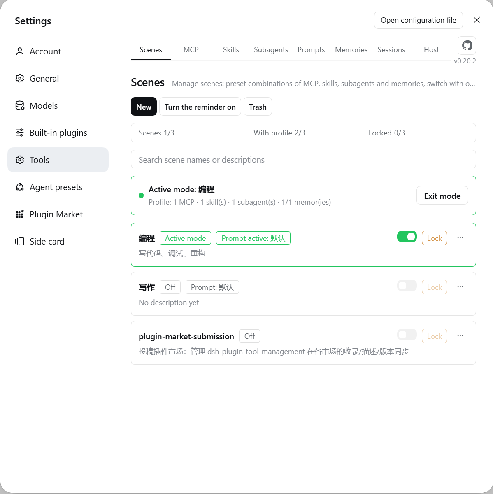
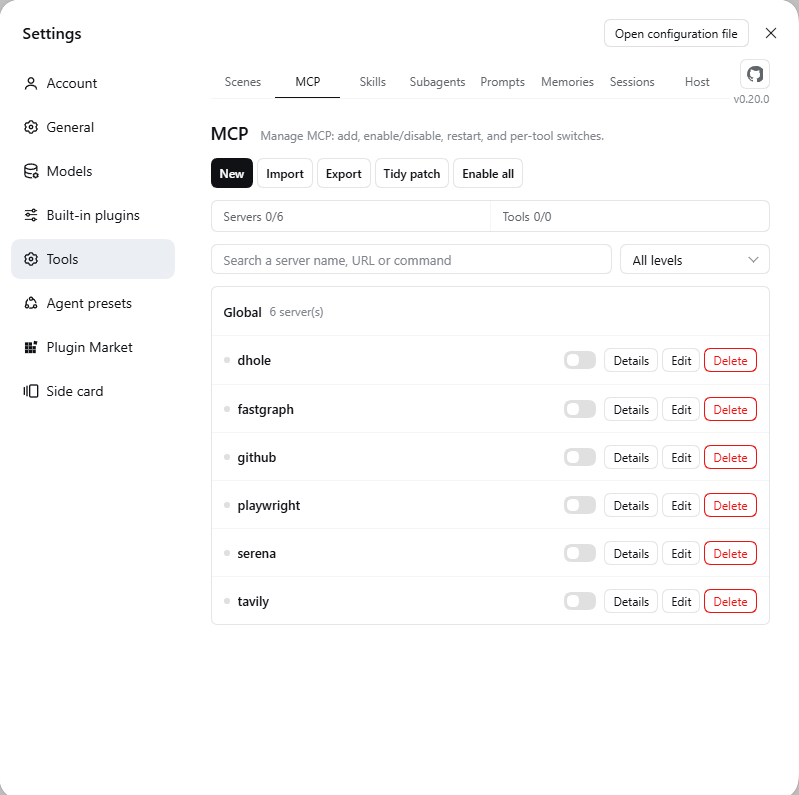
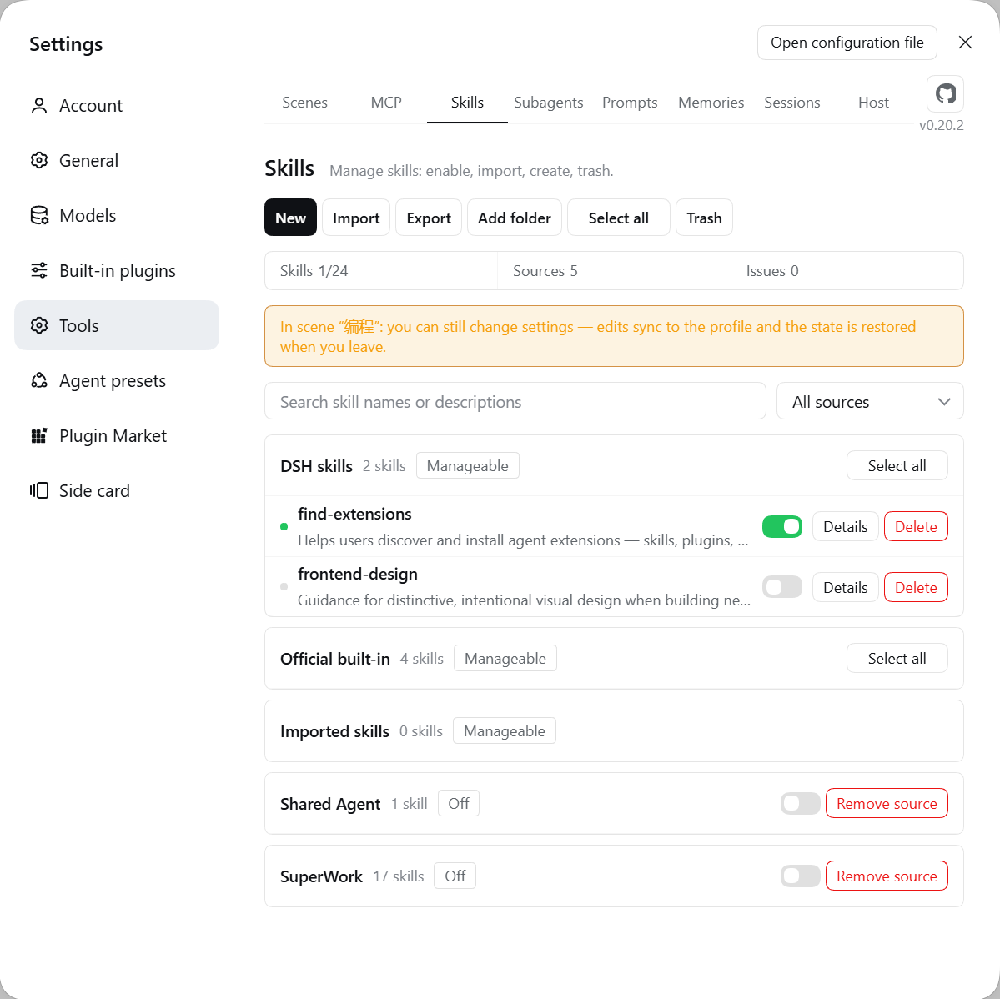
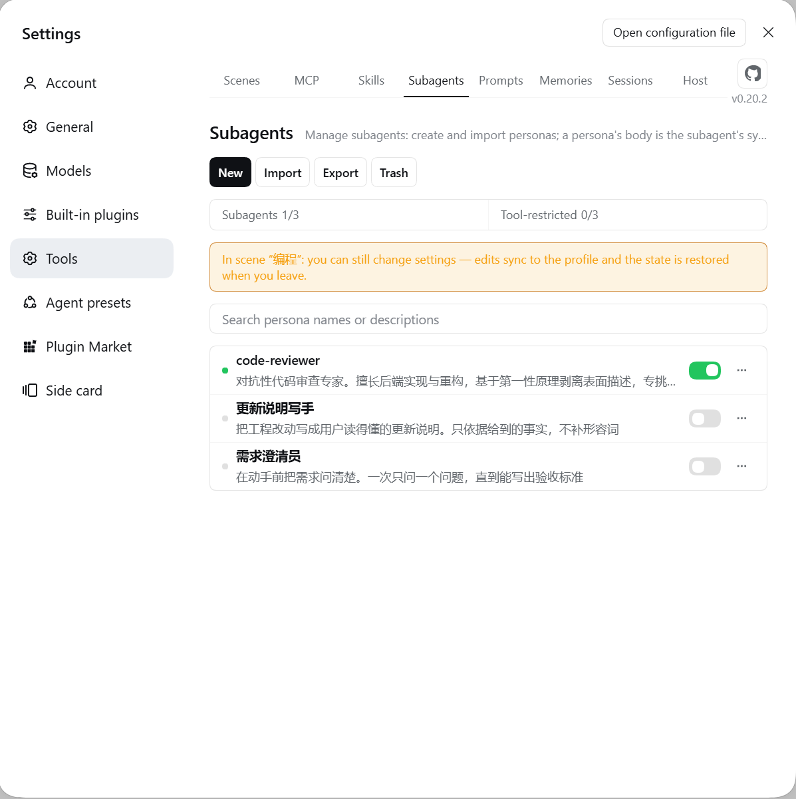
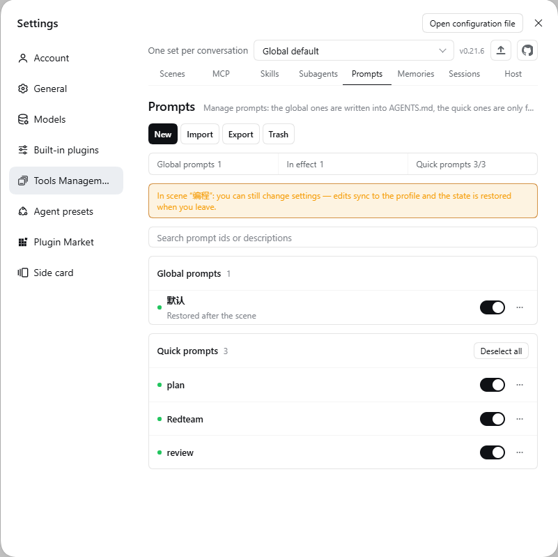
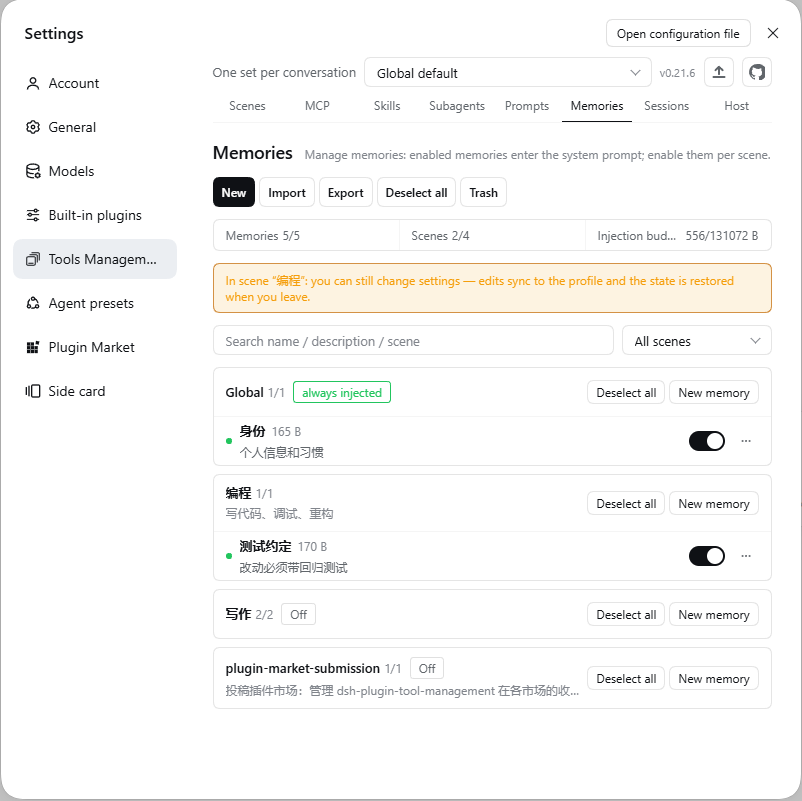
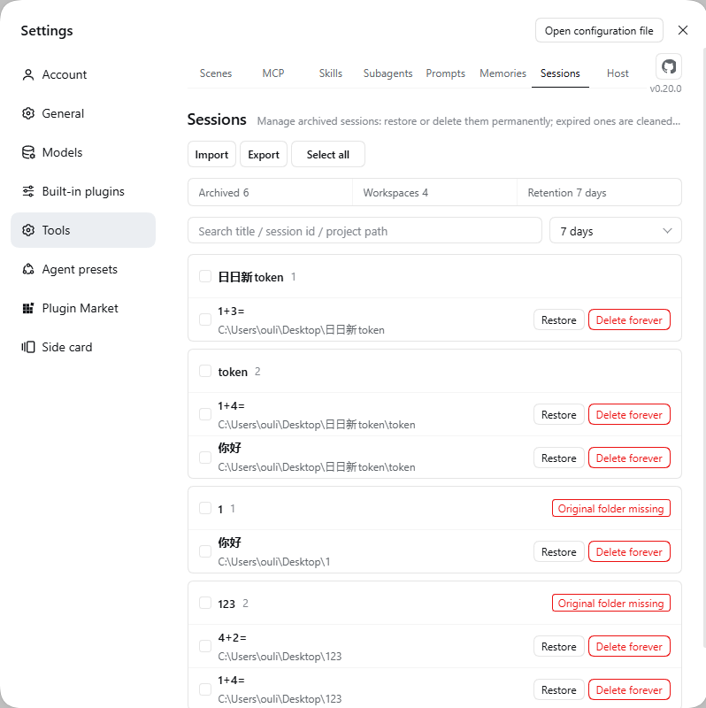
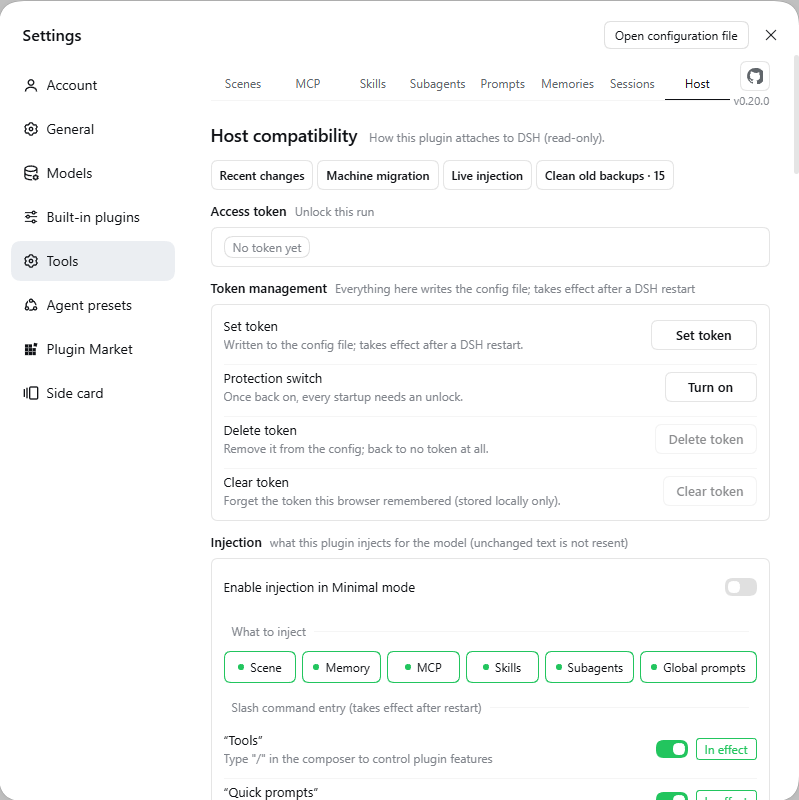

<p align="center">
  
</p>

# dsh-plugin-tool-management

[](https://www.npmjs.com/package/dsh-plugin-tool-management)
[](LICENSE)
[](package.json)
[](https://github.com/ouli-1242/dsh-plugin-tool-management)

[](https://dsh.market/)
[](https://awesome-dsh-plugin.com)
[](https://dshfind.com/en/plugins/ouli-1242/dsh-plugin-tool-management)
[](https://github.com/0xsline/awesome-deepseek-harness)

[简体中文](README.md) · **English** · [Changelog](CHANGELOG.md) · [Release overview](docs/UPDATE.md)

An **MCP, skills, scenes, memories, subagents, prompts & archived sessions** manager for DeepSeek Harness. Eight tabs: Scenes / MCP / Skills / Subagents / Prompts / Memories / Sessions / Host.

```sh
dsh plugin --profile web add dsh-plugin-tool-management@latest      # web
dsh plugin --profile desktop add dsh-plugin-tool-management@latest  # desktop
```

Hard-refresh the browser after installing for web (Cmd/Ctrl+Shift+R), or restart the desktop app after installing for desktop — a **Tools Management** panel in Settings means it worked. The plugin only writes its own files, never touches skill sources, and your configuration survives restarts and upgrades.

---

## Demo

<video controls src="https://github.com/user-attachments/assets/8f785896-891a-4a91-9845-768a1d0bc829"></video>

Every interface shown is a real screenshot of the running product — no redrawn UI, no fabricated controls.

Music: Kevin MacLeod「Limit 70」, [CC BY 4.0](https://creativecommons.org/licenses/by/4.0/).

---

## Screenshots

|                                   |                                    |
|:---------------------------------:|:----------------------------------:|
|    |        |
| **Scenes**                        | **MCP**                            |
|    |  |
| **Skills**                        | **Subagents**                      |
|   |   |
| **Prompts**                       | **Memories**                       |
|  |       |
| **Sessions**                      | **Host**                           |

## Highlights

In one line: **configure "work / writing / coding" each as a scene and switch the whole stack with one click — and the model always sees whatever this plugin manages.**

| Highlight                     | What it means                                                                                                                                                                                                      |
| ----------------------------- | ------------------------------------------------------------------------------------------------------------------------------------------------------------------------------------------------------------------ |
| One-click scene switch        | Each scene carries its own MCP / skills / personas / memories; entering applies them, leaving restores. The model can switch for you too                                                                           |
| Manage without leaving chat   | Type `/` for a "Tools" section and toggle any domain's items — one click, done                                                                                                                                     |
| Memories reach the model      | A few `.md` files under a scene become its knowledge base, injected automatically                                                                                                                                  |
| Notes for MCP servers         | A note you write is seen by the model every turn and acted on                                                                                                                                                      |
| Disable a single tool         | Mute one tool on a server: invisible to the model and uncallable                                                                                                                                                   |
| Skills at a glance            | The copy in effect is marked "preferred"; shadowed ones name the winning source                                                                                                                                    |
| Subagent = one file, one role | Write a role file and delegate to it; only the result comes back, never in History                                                                                                                                 |
| Several prompt presets        | Keep multiple `AGENTS.md` baselines and switch with one click; each scene can bind its own, or none                                                                                                                |
| Sessions no longer lost       | Archives grouped by project, searchable, batch-restorable; imports Claude Code / Cursor / Codex transcripts                                                                                                        |
| The model always sees it      | One context message per domain, republished only when the content changes                                                                                                                                          |
| Lock it and relax             | Locking a scene makes create/update/delete across the five domains read-only                                                                                                                                       |
| Deleted is not gone           | Skills / memories / personas / presets / scenes land in a recycle bin (permanent session deletion excepted); tick items to delete in bulk, or set a retention period so it cleans itself (keep-forever by default) |
| Safe by default               | Only the plugin's own files are written; secrets masked, plaintext needs a token                                                                                                                                   |
| Per-conversation or workspace | Pick a layer at the top of the panel; every domain's toggles apply to that layer only (all global / per conversation / per workspace), the others stay as they were                                                     |

## Quick start

Prerequisites: DSH installed (`dsh web` runs), Node.js ≥ 18. Pick the profile matching your client: `--profile web` for the browser app, `--profile desktop` for the desktop app. The desktop profile is initialized by DSH Desktop itself — open the app once, then quit it completely before running the command.

```sh
dsh plugin --profile web add dsh-plugin-tool-management@latest         # web · install / update
dsh plugin --profile web remove dsh-plugin-tool-management             # web · uninstall
dsh plugin --profile desktop add dsh-plugin-tool-management@latest     # desktop · install / update
dsh plugin --profile desktop remove dsh-plugin-tool-management         # desktop · uninstall
```

Two reasons you might not get the newest release, and neither one errors out: npm mirrors / proxies lag behind, and pnpm's `minimumReleaseAge` (release cooldown) skips anything published inside the window. You just quietly end up on an older version. Pinning an exact version bypasses `@latest` resolution:

```sh
dsh plugin --profile web add dsh-plugin-tool-management@0.21.2
```

To check what you actually got: the "plugin adapter version" on the **Host** tab is the version baked into the code **loaded this session** (not what `package.json` says), and it should match `version` in `~/.dsh/tool-management/mount.json`.

Hard-refresh the browser (web) or restart the desktop app, then a **Tools Management** panel with eight tabs means it worked. Client changes hot-reload; host-side changes need the client restarted (`dsh web` / the desktop app).

You can also ask the model:

```text
Install the dsh-plugin-tool-management plugin:
dsh plugin --profile web add dsh-plugin-tool-management@latest
Then remind me to hard-refresh the browser.
```

For the desktop app, swap `web` for `desktop` and end with "remind me to restart the desktop app" instead.

## Features

### Slash commands (manage from the chat box)

- **Type `/` for a "Tools" section**: scenes / skills / MCP servers / subagents / prompts / memories. Click a row to enter that domain, click an item to apply it; the menu stays open and the command text is cleaned out of the input.
- **State is visible**: green check / empty box / note in grey, plus a status summary on the domain row.
- **Long lists stay out of the way**: every domain lists in full and scrolls on its own; skills group by source directory, memories by scene, enabled ones first.
- **Both kinds of prompts are here**: the global group picks which one is written into `AGENTS.md` (single-select); the quick group is on/off, and clicking one pastes the saved text into the input box without sending it.
- **Only reversible actions**: entering a scene and the various toggles; create / delete / edit / import / export stay on their own pages.

### Scope isolation (all global / per conversation / per workspace)

- **One panel, three granularities**: switch between "all global", "per conversation" and "per workspace" on the Host tab — all-global has no conversation layer, so every conversation shares one set (the way it worked before scopes existed); per-conversation keeps A and B apart; per-workspace shares one copy inside a workspace while different workspaces stay isolated; conversations without a cwd (or with an overlong path) stay independent. Switching away deletes nothing — switch back and it all returns.
- **Four layers stack up**: overrides made on this layer > the entered scene > the snapshot taken when the conversation was created > global; each cell takes the topmost layer that has a say, and matching the lower value clears the override.
- **Enter and leave scenes from a conversation**: from the Scenes page or the `/` menu; the archive's memories / skills / personas / MCP servers apply live to the current layer, and leaving returns to how that layer started (never back to a global that keeps changing).
- **Eight domains follow the current layer**: scenes, skills (incl. source directories), subagents, memories, quick prompts, MCP server and per-tool visibility, and the model tool table (one whole list per layer; the global one is only the default for new conversations / workspaces).
- **Globally off, still usable here — with honest badges**: a server or skill source runs as a lease for the current layer, invisible to others; seven domains plus per-tool cells show live badges; a row's "Close everywhere" stops it immediately and switches it off in the conversations / workspaces using it too (one-shot; you can turn it back on later); while leases exist, the Scenes / MCP / Skills / Subagents / Prompts / Memory pages show "Close all" in the header to clear every lease in that domain at once.
- **Prompts can also be overridden per layer**: applying a preset or editing the body changes only this layer (sidecar, never `~/.dsh/AGENTS.md`); the preset library stays global, so edit it on the global layer.
- **Model tools write to the current layer by default**: receipts name the layer; `scope: "global"` changes the global one. Two independent locks: the scene lock freezes global writes, the conversation / workspace lock only that layer.

### Scenes & memories

- **A scene = a group, a memory = a `.md` file**: `memories/<scene>/<name>.md`, the whole body is injected, file names may be Chinese.
- **"Enabled" and "entered" are two axes**: enabled decides which scene the injection follows (single-select; none enabled = only `global` and `_shared`); entering applies the scene's whole MCP / skills / personas set and writes its bound prompt into `AGENTS.md`.
- **Scene profile**: each scene pairs a set of MCP tools (with scene-level note overrides) / skills / subagents / quick prompts / a model tool-table scheme, plus a bound global prompt preset; ticked = on, unchecked = off, a section never created means that domain is off (quick prompts excepted: unbound = left alone on entry); leaving restores the pre-scene state.
- **Every domain also offers "None"**: this scene leaves that domain alone (the prompt cell = leave `AGENTS.md` as-is; quick prompts = none enabled). It differs from "keep current" — that one really changes nothing.
- **Scene lock** makes those five domains read-only.
- **Deleting a scene takes its memories with it**: the record, the profile and every memory go into one recycle-bin entry and come back together; a scene in use refuses to be deleted.
- **Import / export** `.md` / `.zip` (directory name = scene, bundles carry attachments), same names skipped and never overwritten; the injection budget defaults to 128 KiB, and anything that does not fit is skipped and listed.

### Subagents

- **One file per persona**: `subagents/<persona>.md`, frontmatter entirely optional; `output:` gives one line per requirement for what the result must look like. The body is used verbatim under a `# Persona: <name>` heading, and the file itself needs no changes.
- **Delegation**: `subagent_manager_run` runs with the persona, returns only its final result, and never enters History; it starts a fresh session by default, and `inherit: true` seeds it with this conversation's finished turns.
- **On/off and catalogue**: a disabled persona is neither injected nor visible to the model (the file stays put); new / imported / restored personas start disabled. The catalogue lists name + description only.
- **Tool limits per agent preset**: one allow or deny list per preset (mutually exclusive); candidates list only that preset's own tools, split into "plugin tools / official tools / other tools".
- **Model and provider**: both are picked from the host LLM catalogue (choosing a provider narrows the model list); empty means inherit the main session, and the reasoning-effort level comes from the chosen model.

### MCP servers

- **CRUD with immediate effect**: written into `cordis.patch.yml`, backed up before every change; scope is "global / app-level", and new entries default to global.
- **Per-tool switches**: disable individual tools (invisible and uncallable to the model), or a whole server in one go.
- **A stopped server still shows its list**: tools last seen are listed with their descriptions (marked "as of last run"); one that never ran can be started to read them.
- **Notes and secrets**: a per-server note for the model travels along with the status section; credentials are masked as a whole (`$VAR`, `!!js` and similar indirect references are left alone), and "Reveal" needs a token.
- **Migration and backups**: a cross-scope migration rolls back on failure; JSON export/import is supported.

### Skills

- **Sources at a glance**: project / DSH / Agents / Codex / Claude / custom directories, grouped by source.
- **Opposite permissions**: default sources are readable and their skills deletable; external directories can be disabled or removed but their files stay read-only.
- **Remove ≠ disable**: removing stops scanning the directory at all (nothing is written, restorable); disabling keeps it listed but uncallable.
- **The winning copy of a shared name** is marked "preferred", and the ones it shadows are marked with their source.
- **Custom directories / ZIP import-export / recycle bin.**

### Prompt presets

- **Multiple `~/.dsh/AGENTS.md` baselines**, applied with one click (next turn), with 5 generations of backups; each preset can carry a one-line description that lives only on the plugin side; the last applied preset is always identifiable, even after you edit `AGENTS.md` by hand.
- **The switch on the left of a card is the answer to "is this one in effect"**: flip it on and that preset is written into `AGENTS.md`; flip it off to **un-apply**. The confirmation says which one it will be (the button turns red when the file is going to be deleted), and a receipt follows.
- **"Un-apply" goes back to the start of the chain, not one step**: it restores whatever was there before this run of apply / un-apply began (deleting the file if there was none); every intermediate version stays in `__last-applied__/AGENTS.md.bak-*` (5 generations), so it can be applied again.
- **Two kinds cannot be deleted directly**: a scene-bound preset, and the one currently applied (un-apply it first). The copy auto-created on first open was never applied and can be deleted. Deletes always go to the recycle bin.
- **Quick prompts** (the second section on the same page): save a piece of text you keep typing, then hit `/` and click it to paste it in; a scene can bind a set of them (only the ticked ones are on while the scene is entered, restored on exit, or pick "None").
- **The shared global instruction file is visible too**: `~/.agents/AGENTS.md` is shared with other agent tools and is also injected; when it exists the page says so (read-only — edit that file to change it).

### Archived sessions

- Grouped by project, searchable, batch restore / delete, retention auto-cleanup; a workspace whose registration was deleted can be re-registered in one click.
- Import Claude Code / Cursor / Codex / any text (pick a workspace, browse for one, or type a path).
- Export Markdown / JSONL in three cumulative modes: text only → plus tool calls → plus reasoning. **An export is a transcript, not a backup** — use "archive" to keep everything.

### Host compatibility

- **Host tab**: host version, usable capability count, per-action routing (native / adapter / unavailable), degradations and reasons; three write entries: access token, injection settings, model tool table.
- **Compatibility page overview**: one row per feature point. The four host contracts (subagent persona delegation / tool restriction / creation ordering / Web admission) and the "bare module resolution" block all live there — a feature that silently stops working after a host upgrade shows up at a glance.
- **Sidebar entry**: a "Tools Management" row in the sidebar opens the same eight pages; the Host tab's "Hide from sidebar / Show in sidebar" button adds or removes that row at any time (on by default, alongside Settings → Tools Management).
- **Command line**: `node scripts/doctor.mjs` (health check), `node scripts/host-deps.mjs --fix` (align dependencies).
- Under a **suppressing preset** such as `minimal`, this plugin's injection is off by default; the Host tab can force any domain back on.
- Unchecking "Skills" or "Prompt" really stops them — under standard presets the host delivers those two itself; the other three domains follow the checkbox exactly.
- **What the injection looks like**: one framed message per domain. Names, descriptions, notes and bodies go in verbatim, and a hand-written frame-closing marker inside the body is escaped so it cannot end the frame early.

---

## Where data lives

| Content                                                        | Location                                                                                         |
| -------------------------------------------------------------- | ------------------------------------------------------------------------------------------------ |
| MCP definitions                                                | `~/.dsh/cordis.patch.yml` (written by the plugin; pre-write copies land in the hub's `backups/`) |
| Skill policy / custom dirs                                     | `~/.dsh/tool-management/skills-state.json`                                                       |
| Skills / memories / personas / presets                         | `~/.dsh/tool-management/{skills,memories,subagents,prompts}/`                                    |
| Subagent toggles                                               | `~/.dsh/tool-management/subagents-index.json`                                                    |
| Recycle bin (skills / memories / personas / presets / scenes)  | `~/.dsh/tool-management/trash/<domain>-trash/` (one directory per kind)                          |
| Archive ledger / retention                                     | `~/.dsh/tool-management/history-*.json`                                                          |
| Recycle-bin retention                                          | `~/.dsh/tool-management/trash-retention.json` (`0` = keep forever)                               |
| Memory index / scenes / profiles                               | `~/.dsh/tool-management/memories-index.json`                                                     |
| MCP sidecars (disabled tools / known tools / notes / settings) | `~/.dsh/tool-management/mcp-*.json`                                                              |
| Injection settings (six domain switches)                       | `~/.dsh/tool-management/inject-settings.json`                                                    |
| Model tool table (global default + saved sets)                 | `~/.dsh/tool-management/tool-table.json`                                                         |
| Scope overrides (conversation / workspace, incl. tool table)    | `~/.dsh/tool-management/scope-overrides.json`                                                    |
| Global intent (default MCP / skill-source switches)            | `~/.dsh/tool-management/scope-intent.json`                                                       |
| Scene page preference (preview card before entering a scene)   | `~/.dsh/tool-management/scene-settings.json`                                                     |
| Runtime log / patch backups                                    | `~/.dsh/tool-management/tool-management.log` · `backups/`                                        |

**No user data is stored inside the plugin's install directory** (`dsh plugin update` replaces it wholesale). `backups/` keeps **5 copies per patch file** — the global patch and each profile patch count separately.

The six recycle bins each own one directory under `trash/`: `{skills,memories,subagents,prompts,scenes,quick-prompts}-trash/`. The memories one moved in from the hub root on 2026-10-10; existing data is carried over by the startup migration.

## Configuration & security

| Field           | What it does                                                                                                                                                                                                                                                    |
| --------------- | --------------------------------------------------------------------------------------------------------------------------------------------------------------------------------------------------------------------------------------------------------------- |
| `token`         | Access token. Once set, **every write and every plaintext credential** requires `x-dsh-token`; with no token the plaintext endpoints are closed entirely. Prefer not to keep it in the config? Use the `DSH_PLUGIN_TOOL_MANAGEMENT_TOKEN` environment variable. |
| `tokenDisabled` | `true` = the token stays in the config but is not enforced (this is the line written by "Turn protection off"). Writes no longer need it; revealing plaintext still does.                                                                                       |
| `maxBodyBytes`  | Request body cap, 88 MiB by default.                                                                                                                                                                                                                            |

**Plaintext on disk (read this)**: masking is **display-only**; MCP `env` / `headers` and the plugin's own `token` stay in cleartext inside `cordis.patch.yml` (and each profile copy), and every config change copies the whole file into `~/.dsh/tool-management/backups/` — unencrypted, never rotated, not reclaimed on uninstall. One secret can therefore exist as `5 × (patch files holding it) + 1` plaintext copies. The token gate decides *who may read plaintext over HTTP*; it does nothing about *reading the files*, where the only defence is your filesystem permissions. **To clean up: Settings → Tools Management → Host → "Clean old backups"**.

- **Browser**: reads and writes go through cookies, no token needed; **plaintext credentials** (reveal / export) do. The token is managed in the **Access token** block on the Host tab.
- **Every destructive direction asks for the current token again** (turn protection off / change / delete). Being unlocked this run does not count.
- **curl / scripts**: send `x-dsh-token`, or carry the browser cookie. Except for the fence's 401 / 403, failures come back as **HTTP 200 + `{ ok: false, error }`** — branch on `body.ok`.
- **Port forwarding**: when the host has no `connection` service the fence falls back to "loopback Host + same origin", which any local process can imitate. If you forward the port to a LAN or the public internet, **configure a token**.
- **Avoid `__` in a server name**: a tool's full name is `mcp__<server>__<tool>`, so an extra `__` inside a server name makes it ambiguous; the Host tab shows an informational note.
- **Do not hand-edit the sidecars**: if `mcp-disabled-tools.json` is corrupted every `mcp__*` tool is refused (the MCP page offers "Reset table" and keeps a forensic copy first); if `tool-table.json` is corrupted the last good value stays in effect and saving is blocked.

## FAQ

The full runbook (symptom → why → how to confirm → how to fix) lives in **[docs/TROUBLESHOOTING.md](https://github.com/ouli-1242/dsh-plugin-tool-management/blob/main/docs/TROUBLESHOOTING.md)**. Only the most common cases are listed here.

| Symptom                                                               | Fix                                                                                                                                                                                    |
| --------------------------------------------------------------------- | -------------------------------------------------------------------------------------------------------------------------------------------------------------------------------------- |
| Pages missing after install                                           | Hard refresh; restart DSH if that fails.                                                                                                                                               |
| Duplicate MCP tabs                                                    | Remove the stale loader row from `cordis.patch.yml`, restart.                                                                                                                          |
| Broken config, DSH won't boot                                         | Restore the newest `cordis.patch.yml.<level>.bak-<timestamp>` from `~/.dsh/tool-management/backups/` (5 per patch file).                                                               |
| Action stopped working after a DSH upgrade                            | Settings → Tools Management → **Host** for the reason; `doctor.mjs` → `host-deps.mjs --fix`.                                                                                                      |
| Won't install / peer mismatch after a DSH upgrade                    | This plugin only supports DSH **0.2.1** (`>=0.2.1-rc.2 <0.2.2`). For any other host generation, install the plugin release that matches it.                          |
| The model cannot call a tool it should have                           | Check the **Model tool table** on the Host tab (pick that conversation / workspace in the layer picker first) — 20 tools ship switched off. The panel and scripts are unaffected either way.           |
| Still asked to confirm with `approval=never`?                         | No card appears — straight through with a log line. Switch back to "workspace write" to get the questions again.                                                                       |
| `subagent_manager_run` reports provider unavailable                   | The provider is not registered: `spawn` (default) / `fork` (`inherit`) come from `@deepseek-ai/dsh-subagent-spawn-in-process` / `-fork-in-process` — mount and restart.                |
| Scene binds persona A, but the official `subagent` ran something else | Those two are host tools and this plugin cannot hide them; work matching a persona goes to `subagent_manager_run`, host tools only when no persona fits or a background job is needed. |

---

## Docs

| Doc | When to read it |
| --- | --- |
| [Troubleshooting](https://github.com/ouli-1242/dsh-plugin-tool-management/blob/main/docs/TROUBLESHOOTING.md) | No panel after install, duplicate tabs, actions broken after an upgrade, corrupted disable table or sidecars |
| [Architecture](https://github.com/ouli-1242/dsh-plugin-tool-management/blob/main/docs/ARCHITECTURE.md) | How content reaches the model, why one switch differs between two conversations, which file a change lands in |
| [Compatibility matrix](https://github.com/ouli-1242/dsh-plugin-tool-management/blob/main/docs/COMPATIBILITY.md) | Per-host capability matrix (verified / untested / unavailable) |
| [CHANGELOG](https://github.com/ouli-1242/dsh-plugin-tool-management/blob/main/CHANGELOG.md) | What changed in each release |

---

## Development

```bash
npm install
npm run build        # tsc + sync client
npm test             # build + i18n + contract tests (pure-function invariants & host contracts)
npm run check:i18n   # dictionary self-check
npm run doctor       # host compatibility check
```

`lib/` is not tracked — run `npm run build` after cloning. Changes need `dsh web` restarted. Runtime deps: `fflate` (export bundling) and `js-yaml` (parse check before writing host patches, loaded lazily); `@deepseek-ai/*` all come from the host.

> **Deployment note**: the profile mirror produced by `npm run build` does **not** include `node_modules`, so a runtime dependency added locally (e.g. `js-yaml`) must either be installed on the profile side or accepted as "patch-write check skipped and reported". Regular `npm install` deployments are unaffected.

## License

MIT
