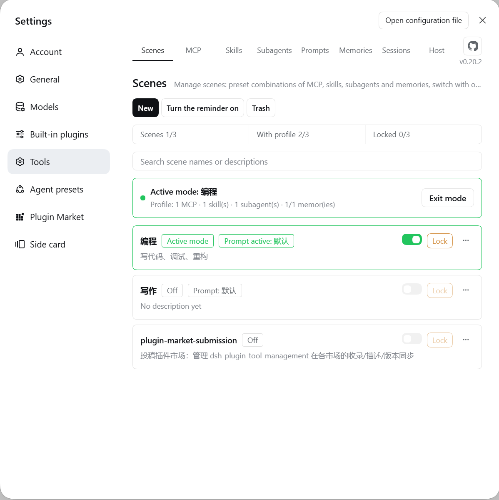
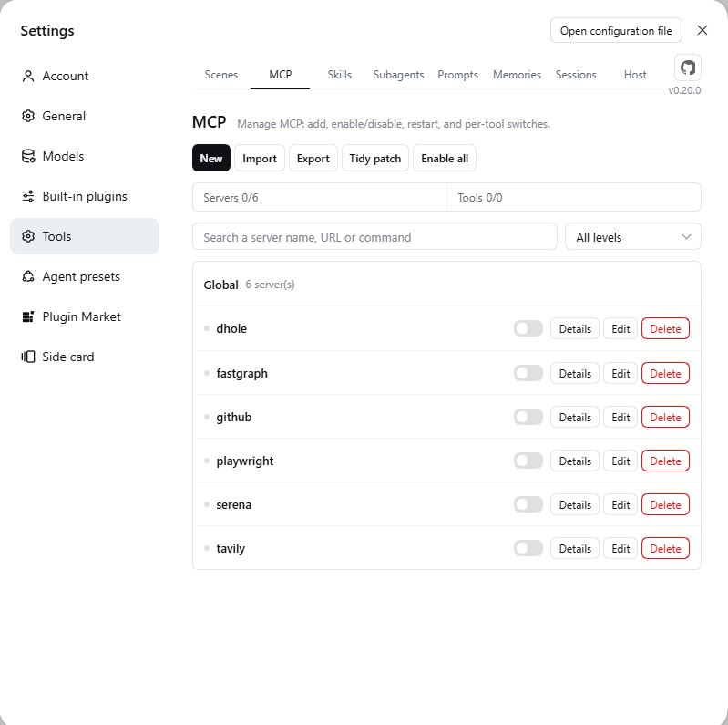
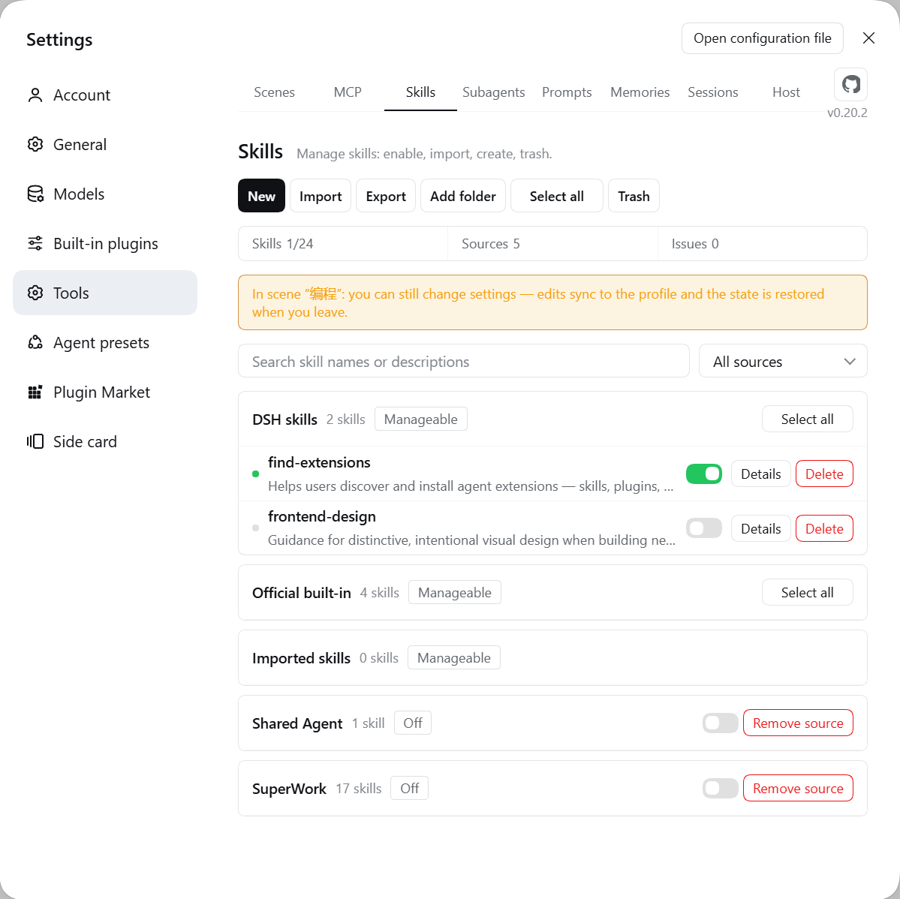
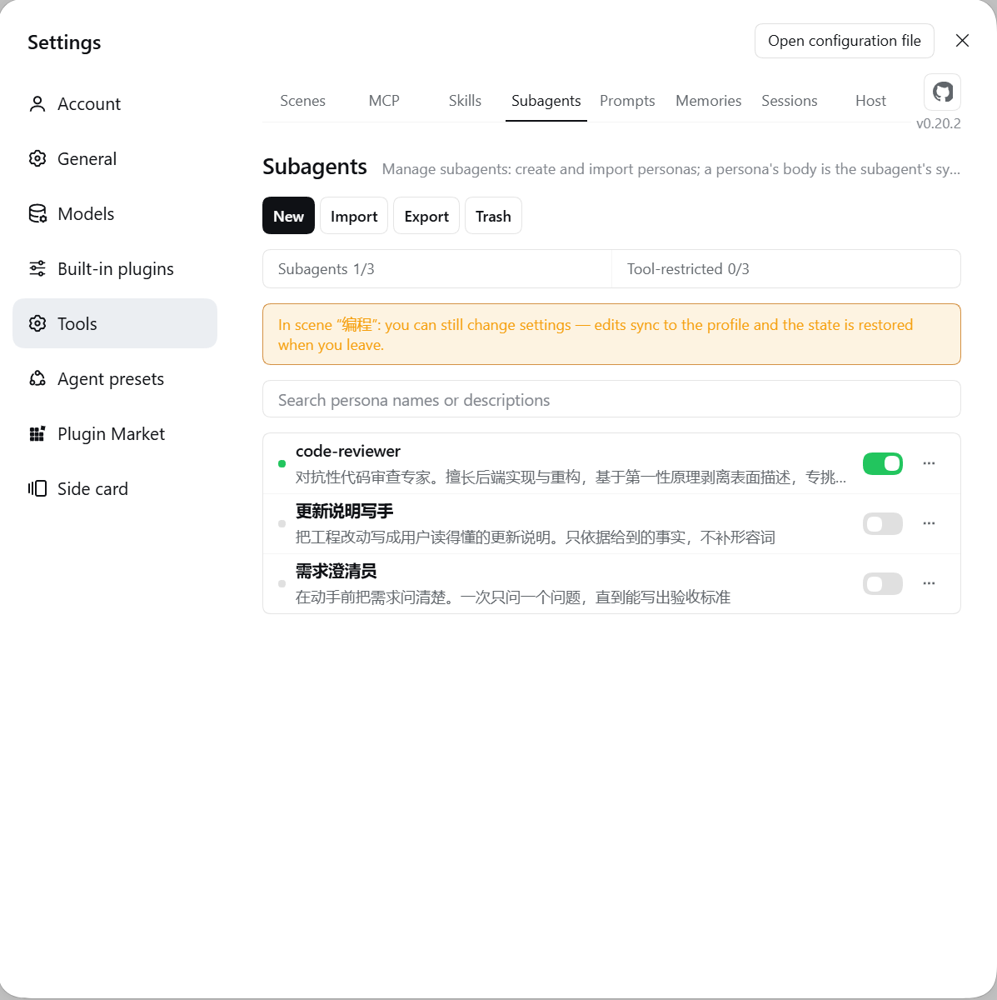
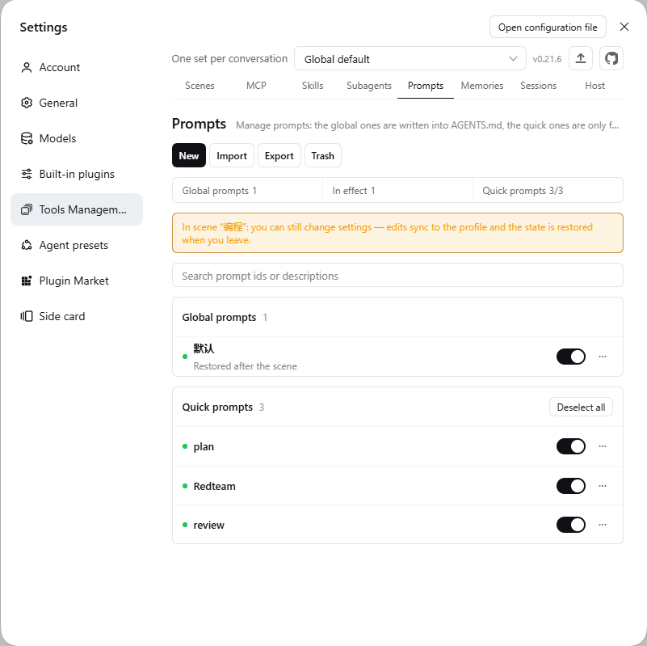
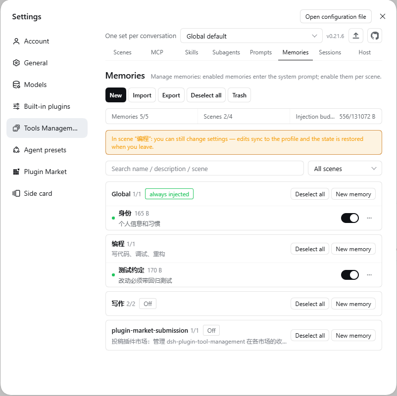
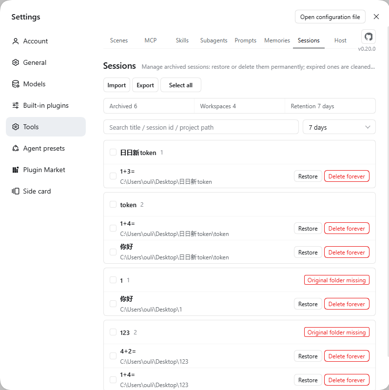
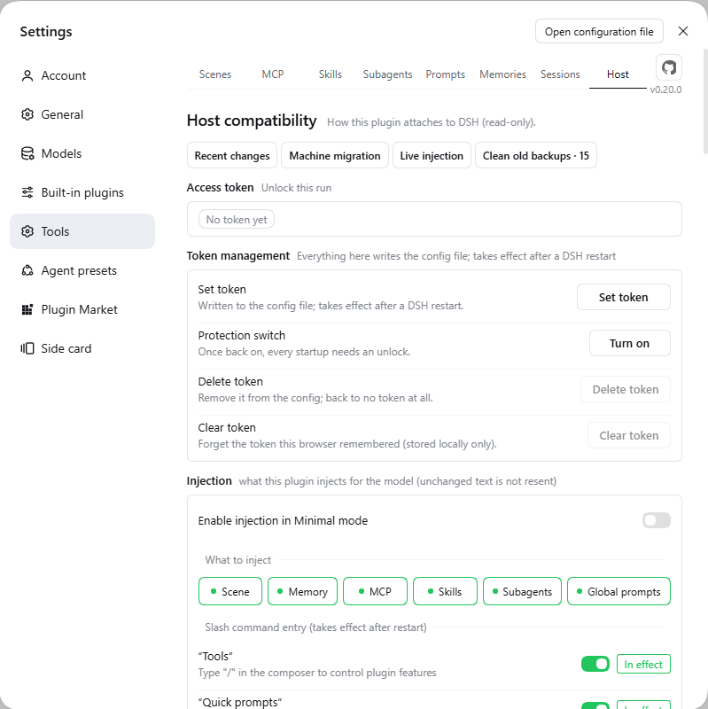

<p align="center">
  
</p>

<p align="center">
  <a href="https://www.npmjs.com/package/dsh-plugin-tool-management"></a>
  <a href="LICENSE"></a>
  
  <a href="https://github.com/ouli-1242/dsh-plugin-tool-management"></a>
</p>

<p align="center">
  <a href="https://dsh.market/"></a>
  <a href="https://awesome-dsh-plugin.com"></a>
  <a href="https://dshfind.com/en/plugins/ouli-1242/dsh-plugin-tool-management"></a>
  <a href="https://github.com/0xsline/awesome-deepseek-harness"></a>
</p>

<p align="center">
  <a href="README.md">简体中文</a> · <b>English</b> · <a href="CHANGELOG.md">Changelog</a>
</p>

MCP servers, skills, subagents, prompts, memories and archived sessions for DeepSeek Harness — all in one panel. Bundle them into a **scene**, swap the whole environment with one click, and roll back to the pre-entry snapshot when you leave.

```sh
dsh plugin --profile web add dsh-plugin-tool-management@latest      # web
dsh plugin --profile desktop add dsh-plugin-tool-management@latest  # desktop
```

Hard-refresh the browser after installing for web (Cmd/Ctrl+Shift+R), or restart the desktop app — then open **Settings → Tools Management**. For desktop, open the app once and quit it completely before running the command. An older version usually means registry lag or pnpm's `minimumReleaseAge` — install an exact version (`@0.X.X`) instead.

---

## Highlights

<table>
<tr>
<td width="33%" valign="top"><b>One-click scene switch</b><br>Each scene stores a full profile: MCP, skills, subagents, memories, quick prompts, a prompt preset and a model-tool table. Enter it and the whole stack switches; leave it and the pre-entry snapshot comes back.</td>
<td width="33%" valign="top"><b>Control from the chat</b><br>Type <code>/</code> for a “Tools” section: enter or leave a scene, toggle any of the six domains. The menu stays open and leaves no command text in the composer.</td>
<td width="34%" valign="top"><b>Three scopes</b><br>All global / per workspace / per conversation. By default every conversation has its own settings — two conversations in the same project can run two different environments at once.</td>
</tr>
<tr>
<td valign="top"><b>The agent can drive it</b><br>23 model tools across six domains: list, read, create, update, delete, toggle, enter scenes, apply prompts, run personas. Writes ask for confirmation (except in a full-permission session, where the card is skipped and only a log line is written); disabled tools are not in the schema at all.</td>
<td valign="top"><b>The Host page is a control center</b><br>Version and capability checks, access token, scope mode, per-domain injection switches, the model-tool table and the sidebar entry — all on one page.</td>
<td valign="top"><b>One panel, eight tabs</b><br>Scenes / MCP / Skills / Subagents / Prompts / Memories / Sessions / Host — no more hunting through six different settings pages.</td>
</tr>
</table>

## Demo

<video controls width="100%" src="https://github.com/user-attachments/assets/ff3111c3-4228-45b7-9e28-b85dc60fb6b3"></video>

Player refuses to start (browsers with a stricter CSP sometimes block the inline embed)? [Watch the same file directly](https://github.com/user-attachments/assets/ff3111c3-4228-45b7-9e28-b85dc60fb6b3). 

Every interface shown is a real screenshot of the running product. 

Music: Kevin MacLeod「Limit 70」, [CC BY 4.0](https://creativecommons.org/licenses/by/4.0/).

## Screenshots

|                                                                              |                                                                                |
|:----------------------------------------------------------------------------:|:------------------------------------------------------------------------------:|
| <br>**Scenes**     | <br>**MCP**             |
| <br>**Skills**     | <br>**Subagents** |
| <br>**Prompts**   | <br>**Memories**   |
| <br>**Sessions** | <br>**Host**           |

## Three scopes

Every conversation gets its own settings by default. Switch once on the **Host page → Scope**, and the whole panel plus every model tool follows that layer:

|                          | All global                                     | Per workspace                              | Per conversation (default)                 |
|:------------------------ |:---------------------------------------------- |:------------------------------------------ |:------------------------------------------ |
| **Who shares one set**   | Every conversation                             | Conversations in the same workspace        | Each conversation separately               |
| **Best for**             | One person, one machine, consistent everywhere | One project, one environment               | Parallel tasks in one project              |
| **Lost when switching?** | —                                              | Nothing is deleted; switch back to restore | Nothing is deleted; switch back to restore |

The selector at the top of the panel jumps to a specific conversation or workspace and shows its own copy; when that layer is locked, the unlock button sits on the same row. Within a layer, every switch resolves top-down: **this layer's edit > entered scene > creation snapshot > global**.

Scenes work in all three scopes. Under per-conversation, conversation A can sit in “Coding” while B stays in “Writing”, each with its own MCP servers, skills and personas.

## What each tab does

<table>
<tr><th width="15%" align="left">Tab</th><th align="left">What it does</th></tr>
<tr><td><b>Scenes</b></td><td>Save the whole environment as a profile; enter and leave with one click; lock it against edits; bind a prompt preset and a model-tool table; deleting it sends its memories to the recycle bin too.</td></tr>
<tr><td><b>MCP</b></td><td>Add, edit and remove servers; toggle individual tools; write a note the model sees; inspect the last-known tool list while a server is stopped; import/export with automatic backups.</td></tr>
<tr><td><b>Skills</b></td><td>Grouped by source; enable, remove, import, edit; same-name skills show which copy is in effect; external directories stay read-only.</td></tr>
<tr><td><b>Subagents</b></td><td>One <code>.md</code> per persona; delegate work, limit tools, pick a model; only the result comes back, never into your History.</td></tr>
<tr><td><b>Prompts</b></td><td>Multiple <code>AGENTS.md</code> baselines with one-click apply/undo and five generations of backups; quick prompts paste into the composer from <code>/</code>.</td></tr>
<tr><td><b>Memories</b></td><td>Global / workspace / scene layers; <code>.md</code> bodies are injected automatically; import/export, recycle bin, injection budget (shared 256 KiB with learned notes; over the limit, whole entries step aside and are listed).</td></tr>
<tr><td><b>Sessions</b></td><td>Archived by project, searchable, batch restore; import Claude Code / Cursor / Codex transcripts; export Markdown / JSONL.</td></tr>
<tr><td><b>Host</b></td><td>Version and capability checks, access token, scope mode, injection switches, model-tool table, sidebar entry, backup cleanup.</td></tr>
</table>

### Autonomous memory

Off by default. When on, the agent records preferences, facts and corrections worth keeping across conversations — **and asks you in the chat whether to keep each one, and at which scope**.

> **Experimental**: behaviour and UI are still changing. Please [open an issue](https://github.com/ouli-1242/dsh-plugin-tool-management/issues) if something goes wrong.

- **Two independent switches**: global and this workspace can be on together or one at a time; learning and injection both follow them, and the card only lists the layers that are on. On the Memory page global autonomous notes sit inside the Global card, and workspace notes get their own card with a section per workspace.
- **Every learn asks once**: a new note always gets a card — pick "add to global", "add to this workspace", or "do not add". Only two cases skip it: auto-confirm is on (the agent decides), and merging into a note that is already active (the layer is already settled). The agent does not scan the conversation during normal work — when the host compacts the context, that summary is reviewed once for anything durable.
- **Card language, rewording, and pending**: the card uses the language of the note body; type your own wording in the card and it goes back to the model to rewrite, then asks you again. Without an interactive card (background review, headless sessions) the note saves as pending and is handled on the Memory page; with auto-confirm on it goes active directly.
- **Type decides shelf life, and a wrong call is yours to fix**: every note carries a type (preference / fact / correction / procedure). Facts and procedures get a review reminder after 30 days; preferences and corrections never expire. The review card and the editor both state the current type and what it means; if the model got it wrong, change it in the editor and the shelf life is recomputed.
- **Learn only**: the settings panel can turn off “Inject into conversation”. Notes are still learned and still listed on the Memory page — they just stay out of the conversation context, which is useful when you want to watch what the agent would record.
- **Two injection messages**: global learned notes join the always-on block, while workspace learned notes and hand-written workspace memories are merged into one “Workspace memories” block; adding one note re-sends only its block.
- **Evidence comes in three tiers and the model cannot claim one**: a verbatim match of your own words, your confirmation on a card that showed the text, or the agent's own inference — sorting and page labels use those tiers, and `memory_note` has no “I'm confident” parameter to fill in. Something already covered by your own memories is not written a second time.
- **Shared injection budget with hand-written memories**: 256 KiB for everything together; over the limit, whole entries step aside in the order workspace notes → global notes → workspace memories → scene memories → global memories, the ones left out are listed at the end, and the page-header budget turns red.
- **Disable, archive and delete are three different things**: the row switch only flips "not injected for now" — the note stays in the list and flips back any time. The ⋯ menu's reject archives it (no longer injected, folded away in the list, restorable at any time, file untouched). Only delete moves it to the recycle bin and writes a tombstone, so the wording cannot be re-learned for 30 days; restore or delete it permanently from there. The ⋯ menu also edits the body.
- **Background review and upkeep**: review runs only when the host compacts the context — no compaction, no review; failures retry with backoff and have a manual retry entry; maintenance runs at most once a day and only changes status, never deletes files. Bodies and state live under `evolution/notes/`, and the tool never appears in the model tool table or follows scenes — only the two switches.

## Let the agent drive it

Six domains, **23 model tools**: list, read, create, update, delete, toggle, enter or leave a scene, apply a prompt, run a persona. 22 of them can be toggled individually in the tool table; `memory_note` follows the autonomous-memory switch.

- **Only 5 ship enabled** (`tool_manager_tools` / `memory_get` / `memory_remember` / `skill_manager_read` / `subagent_manager_run`); the other 18 stay off. Off means **not in the schema at all** — the model cannot see them, let alone call them.
- **Scoped writes**: the model writes to the current layer by default and the receipt says which one; `scope: "global"` is required to touch everything.
- **Confirmation cards**: stopping servers, deleting, machine-wide toggles and similar writes ask first; recovery actions (restart, restore, undo apply) go straight through.
- **Per-tool control**: the model-tool table on the Host page adjusts visibility per layer. All 22 on is ~6k tokens/turn; profiles can be saved per task and switched together with a scene.
- **The model can switch tools back on**: the always-on `tool_manager_tools` lists the tools that are off in this conversation (name, purpose, ≈tokens) and turns them on as needed — when the user asks for a scene whose tools happen to be off, the model has a way forward instead of bouncing back to the user.

## The Host page

More than a version number:

- **Checks**: host version, the plugin build actually loaded this run, and whether each action is native / adapted / unavailable, with reasons. Items whose names can be checked but whose timing or rendering cannot are listed under “not automatically verifiable”. If an upgrade quietly breaks something, it shows up here; the “Re-check” button re-runs the probe in place.
- **Upgrade diff**: per-package versions for cordis, the 11 peers and 15 runtime-only official packages against the verified baseline (out-of-range peers become blockers), plus canaries for event names, session-directory layout, patch dialect, MCP config keys and tool argument schemas, prompt section ordering, client UI slots and official skill assets.
- **Access token**: set / disable / change / delete; writes and plaintext secrets go through it.
- **Scope**: all global / per workspace / per conversation.
- **Injection**: per-domain switches, minimal-preset fallback, catalog caps for skills / MCP / subagents (overflow folds into a one-line count; per-entry description length is configurable too), the two slash-menu entries, sidebar entry.
- **Model tools**: per-tool visibility for 22 of them (`memory_note` follows the autonomous-memory switch), saved per layer.
- **Maintenance**: old-backup cleanup, feature overview, recent changes.

<details>
<summary><b>Where data lives · security boundaries</b></summary>

| Content                                                        | Location                                                                     |
|:-------------------------------------------------------------- |:---------------------------------------------------------------------------- |
| MCP definitions                                                | `~/.dsh/cordis.patch.yml` (global) · `~/.dsh/profiles/<name>/cordis.patch.yml` (current profile) |
| Skill policy / custom directories                              | `~/.dsh/tool-management/skills-state.json`                                   |
| Skills / memories / personas / presets                         | `~/.dsh/tool-management/{skills,memories,subagents,prompts}/`                |
| Memory index / scenes / profiles                               | `~/.dsh/tool-management/memories-index.json`                                 |
| Recycle bins (skills / memories / personas / presets / scenes) | `~/.dsh/tool-management/trash/<domain>-trash/`                               |
| Archive ledger / retention                                     | `~/.dsh/tool-management/history-*.json`                                      |
| MCP sidecars (disabled tools / known tools / notes / settings) | `~/.dsh/tool-management/mcp-*.json`                                          |
| Injection settings (six domain switches · catalog caps)       | `~/.dsh/tool-management/inject-settings.json`                                |
| Model-tool table / scope overrides                             | `~/.dsh/tool-management/tool-table.json` · `scope-overrides.json`            |
| Runtime log / patch backups                                    | `~/.dsh/tool-management/tool-management.log` · `backups/`                    |

- **Write scope**: skill sources are never touched; MCP changes go to the two patch files above (five backups each); applying a prompt overwrites the `~/.dsh/AGENTS.md` the host reads (the previous text is kept inside the hub); the desktop build clears `dsh-auth-*` cookies older than ten minutes at startup.
- **Token**: once set, every write and every plaintext secret requires `x-dsh-token`; the UI stores it in browser localStorage bound to the current boot (a restart asks again), and plaintext still needs the token.
- **Process-level boundary is the token**: writes normally sit behind the host's browser auth; when the host fence is absent the route falls back to a loopback-only check, which any local process can pass — only the access token gives you a process-level boundary.
- **Plaintext on disk**: masking happens in the UI only. MCP `env` / `headers` and the plugin `token` stay plaintext in the patch file, and backups are not encrypted. The token gate cannot stop disk reads — file permissions are the boundary.
- **Deletes are recoverable**: skills / memories / personas / presets / scenes go to the recycle bin (permanent session deletion excepted), with an optional retention period (keep forever by default).

</details>

## FAQ

| Symptom                                 | Fix                                                                                                                                                      |
|:--------------------------------------- |:-------------------------------------------------------------------------------------------------------------------------------------------------------- |
| No panel after installing               | Hard-refresh the browser; if that fails, restart DSH.                                                                                                    |
| The model cannot call a tool            | Host page → “Model tools”, make sure the right conversation / workspace is selected (18 tools are off by default). The panel and scripts are unaffected. |
| Actions unavailable after a DSH upgrade | Check the reason on the Host page; run `node scripts/doctor.mjs`, then `node scripts/host-deps.mjs --fix`.                                               |
| Version mismatch                        | Supports DSH **0.2.2** only (`>=0.2.2-rc.1 <0.2.3`); cross-generation upgrades wait for the plugin to catch up. Install 0.21.x for older hosts.          |
| Duplicate MCP tab                       | Remove the old loader line from `cordis.patch.yml` and restart.                                                                                          |
| DSH won't start after a bad edit        | Restore the newest `cordis.patch.yml.*.bak-*` from `~/.dsh/tool-management/backups/`.                                                                    |

Full troubleshooting guide: [docs/TROUBLESHOOTING.md](docs/TROUBLESHOOTING.md).

## Docs

| Doc                                                            | When to read it                                                                                           |
|:-------------------------------------------------------------- |:--------------------------------------------------------------------------------------------------------- |
| [Troubleshooting](docs/TROUBLESHOOTING.md)                     | Missing panel, duplicate tab, actions unavailable after an upgrade, broken sidecars                       |
| [Architecture](docs/ARCHITECTURE.md)                           | How content reaches the model, why one toggle differs between conversations, which file a change lands in |
| [Compatibility matrix](docs/COMPATIBILITY.md)                  | Capability matrix per DSH version (verified / untested / unavailable)                                     |
| [Changelog](CHANGELOG.md)                               | What changed in each version                                                                              |

## Development

```bash
npm install
npm run build        # tsc + sync client
npm test             # build + i18n + contract tests
npm run doctor       # host compatibility check
```

`lib/` is not committed — run `npm run build` after cloning, and restart `dsh web` to pick up changes. Runtime dependencies are `fflate`, `js-yaml` and `semver` (static imports in the build; the plugin will not load without any of them); every `@deepseek-ai/*` package uses the host's copy.

## License

MIT
